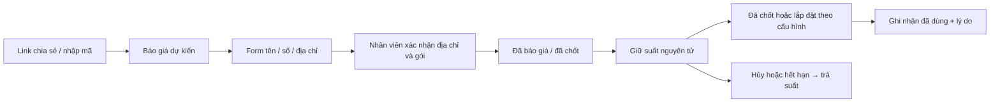

# Voucher khu vực và link chia sẻ

Module Python/FastAPI + PostgreSQL, dùng giao diện Jinja2 hiện có. Trang quản lý: `/admin/vouchers` → **Voucher & Link chia sẻ**. Các thay đổi đang nằm trong workspace; cần áp dụng migration và triển khai phiên bản này để xuất hiện trên website production.

## Cách thiết lập

1. Công bố gói cước, bảng giá và phụ kiện cần dùng ở các mục quản lý hiện có. Nếu tặng thiết bị, chọn phụ kiện tính **một lần**, mở **Tồn kho quà tặng** và nhập tổng tồn kho cùng giá vốn. Tồn kho được dùng chung giữa các voucher.
2. Bấm **Tạo voucher**. Nhập mã, tên chiến dịch, nhãn và điều kiện nhận ưu đãi. Mã dùng chữ hoa, số, dấu `-` hoặc `_`; không đổi mã sau khi tạo.
3. Chọn kỳ thanh toán, gói và dịch vụ. Danh sách gói trống nghĩa là mọi gói; nếu chọn cả gói và dịch vụ thì khách cần đáp ứng cả hai điều kiện.
4. Tìm tên tỉnh hoặc xã/phường, tích checkbox rồi nhập ưu đãi cho từng quy tắc. Có thể giữ quy tắc toàn quốc làm mức mặc định. **Xã/phường → tỉnh → toàn quốc**; địa bàn loại trừ luôn thắng. Nhiều vùng mới sao chép cấu hình từ quy tắc đầu tiên để giảm thao tác; kiểm tra preview trước khi lưu.
5. Nhập thời hạn theo giờ Việt Nam, tổng số suất, ngân sách, suất/khách và thời gian giữ suất. Lịch dùng **dd/mm/yyyy**. Chọn ghi nhận đã dùng khi **Đã lắp đặt** hoặc **Khách đồng ý chốt**.
6. **Lưu bản nháp**, kiểm tra preview, sau đó **Công bố**. Khi có sửa đổi chưa lưu, nút Công bố bị khóa. Sửa bản nháp không đổi ưu đãi khách đang thấy cho đến khi công bố lại.
7. Ở phần Link chia sẻ, chọn trang đích `/`, `/khuyen-mai`, `/do-toc-do` hoặc `/<slug-landing>`, kênh và nhân viên nếu cần. Ví dụ dạng link: `https://fpt-vungtau.com/s/<ten-link>`. Có nút sao chép, tải QR SVG, sửa đích/kênh và tắt link. QR được tạo trong backend; không gửi URL tới dịch vụ QR bên ngoài.

Không có giá hoặc ưu đãi thương mại được tự tạo sẵn. Admin nhập chính sách thực tế trước khi công bố. Tạm dừng nhiều voucher bằng checkbox; cột danh sách sắp xếp hai chiều. Chỉ xóa được voucher chưa công bố, chưa có link hoặc lịch sử; các voucher đã sử dụng cần tạm dừng để giữ lịch sử.

## Tính tiền và hạn mức

- **Giảm thanh toán ban đầu:** trừ vào phần tiền gói và phí thuộc gói, không trừ tiền phụ kiện khách tích chọn.
- **Giảm giá mỗi tháng:** giá gói hiển thị giảm ngay; tổng kỳ giảm bằng mức giảm mỗi tháng × số tháng trả. Trần giảm là trần mỗi tháng.
- **Giảm hòa mạng/thiết bị:** giới hạn theo khoản phí tương ứng. Khi cộng ưu đãi khác, tổng giảm vẫn không vượt phần tiền dịch vụ còn lại; không lấy tiền phụ kiện để bù mức giảm.
- **Phần trăm:** bắt buộc có trần tiền. API nhận BPS (`500` = 5%); giao diện nhập `%`. Tiền làm tròn nguyên VND theo ROUND_HALF_UP. Mức giảm voucher là khoản trừ VND cuối cùng; các dòng VAT gốc được giữ trong snapshot để đối chiếu.
- **Quà tặng:** dùng phụ kiện đã công bố, tính một lần, phù hợp dịch vụ/gói. Không vừa tính tiền thiết bị khách chọn vừa ghi nó là quà. Khách bỏ chọn thiết bị trả phí trùng quà trước khi nhận ưu đãi.
- **Ngân sách:** tiền giảm thực tế + giá vốn quà trong snapshot. Một voucher trên một hồ sơ. Hạn mức tính các suất đã dùng và suất giữ chưa hết hạn; hạn mức theo số điện thoại dựa trên contact của CRM, không dựa trên IP.
- Không thể giảm tồn kho, ngân sách hoặc hạn mức xuống dưới phần đã dùng/đang giữ. Tạm dừng/công bố lại không đổi snapshot của suất đã giữ.

## Quy trình khách hàng và nhân viên

Trên trang chủ, landing và các trang client dùng layout chung, khách có thể mở phần **Có mã ưu đãi?**, xem điều kiện và bỏ mã. Cookie ký, HttpOnly, SameSite=Lax giữ ngữ cảnh ưu đãi tối đa 30 ngày hoặc đến ngày hết hạn. Mở link mới thay ngữ cảnh cũ. Cookie chỉ chứa mã/link công khai, không chứa PII, không dùng làm cookie quảng cáo. Preview landing không bật chức năng gửi voucher.

Mở link, quét QR và xem báo giá **không giữ suất**. Giá hiển thị có voucher là dự kiến, chưa bảo đảm còn quà/suất khi nhân viên kiểm tra. Mã sai, hết hạn hoặc hết suất không làm mất form; CRM lưu được yêu cầu để tư vấn tiếp.

Trong hồ sơ khách, nhân viên được phân công:

1. Dùng **Sửa thông tin & Xác nhận địa chỉ** để chọn tỉnh, xã/phường và địa chỉ cụ thể từ nguồn địa giới hành chính. Không lấy GeoIP làm bằng chứng xã/phường.
2. Đồng bộ gói trong hồ sơ với gói khách chốt và chọn đúng kỳ thanh toán. Chuyển hồ sơ đến Đã báo giá/Đã chốt/Đã lắp đặt theo quy trình hiện có.
3. Ở **Voucher khách quan tâm**, kiểm tra mã và kỳ, bấm **Xác nhận & giữ ưu đãi**. Backend tính lại báo giá và khóa hạn mức, ngân sách, contact cùng tồn kho quà trong giao dịch PostgreSQL. Người thứ hai tranh suất cuối nhận lỗi rõ ràng, không ghi nhận thừa.
4. Bấm **Ghi nhận đã dùng** sau khi đạt trạng thái được cấu hình; nhập lý do. Hoặc **Hủy & trả suất** nếu khách không nhận ưu đãi.

Khi giữ suất, đổi địa chỉ/gói/phụ kiện, đổi gói/kỳ đã chốt hoặc xác nhận một báo giá khác đều phải hủy suất trước. Suất đã dùng là lịch sử, không hoàn tồn kho tự động. Hết hạn tự giải phóng hạn mức theo thời gian database, không phụ thuộc cron; CRM hiển thị báo giá cần xác nhận lại và có thể giữ lại nếu còn suất. Gửi lại cùng yêu cầu giữ/dùng/hủy trả kết quả đã ghi, không trừ hạn mức hai lần.

## Quyền và báo cáo

| Thao tác | Quyền |
|---|---|
| Quản lý chiến dịch, link, xem báo cáo | `marketing.write` cấp toàn hệ thống |
| Công bố, tạm dừng, xóa, sửa tồn kho | Thêm `pricing.publish` và MFA AAL2 |
| Xem/giữ/dùng/hủy voucher trong CRM | `lead.write`, đúng phạm vi/nhân viên phụ trách |
| Xác nhận địa chỉ và đọc PII | Luồng hiện có: `lead.write`, `lead.pii`, MFA |

Các bảng `private.vouchers`, `voucher_links`, `voucher_inventory`, `voucher_redemptions` có RLS và thu hồi quyền `anon`/`authenticated`. Client không truy cập trực tiếp các bảng này. RPC chỉ gọi bằng backend service_role; API vẫn kiểm tra quyền người đang đăng nhập.

Báo cáo gồm yêu cầu ưu đãi, đã xác nhận đủ điều kiện, đang giữ, đã dùng, đã lắp đặt và chi phí thực tế theo chiến dịch/kênh/nhân viên/quy tắc khu vực. **Đủ điều kiện** nghĩa là từng giữ thành công; không phải tổng lượt xem. **Đang giữ** là số suất hiện còn hiệu lực. Hồ sơ chưa xác nhận địa bàn nằm trong nhóm Chờ xác nhận địa bàn. Kênh/nhân viên được chụp khi nhận form; sửa link không đổi lịch sử nguồn. Lượt mở link không được diễn giải thành số khách hay số suất nhận quà.

Module chưa tạo voucher cá nhân hoặc chương trình giới thiệu nhiều tầng. Dữ liệu tracking hiện có tiếp tục dùng cơ chế consent; không thêm số điện thoại, địa chỉ hay IP thô vào log quảng cáo.

## API tích hợp

| Endpoint | Chức năng |
|---|---|
| `GET /s/{slug}` | 302 đến trang nội bộ, ghi cookie ký; không giữ suất |
| `GET /api/v1/vouchers/context` | Đọc ngữ cảnh công khai, `voucher`, `has_context` |
| `POST /api/v1/vouchers/context` | `{code}` để áp dụng và giữ mã nhập trực tiếp |
| `DELETE /api/v1/vouchers/context` | Bỏ cookie ưu đãi |
| `POST /api/v1/quotes` | Thêm `voucher_code`; phản hồi `voucher` và giá server |
| `POST /api/v1/leads` | Thêm `voucher_code`, `voucher_link`; dùng Idempotency-Key như cũ |
| `GET/POST /api/v1/admin/vouchers` | Phân trang danh sách / tạo bản nháp |
| `PUT/DELETE /api/v1/admin/vouchers/{id}` | Sửa có `expected_version` / xóa bản nháp chưa dùng |
| `POST /api/v1/admin/vouchers/{id}/publish` hoặc `/pause` | Công bố/tạm dừng có `expected_version` |
| `GET /api/v1/admin/vouchers/options`, `/employees` | Địa bàn và nhân viên để chọn |
| `GET/PUT /api/v1/admin/vouchers/inventory` | Tồn kho quà, giá vốn và optimistic version |
| `POST /api/v1/admin/vouchers/{id}/links` | Tạo/sửa/tắt link |
| `GET /api/v1/admin/vouchers/links/{slug}/qr` | QR SVG cần phiên đăng nhập có quyền |
| `GET /api/v1/admin/vouchers/report` | Funnel và chi phí |
| `GET /api/v1/admin/leads/{id}/voucher` | Yêu cầu, kỳ đã chốt, suất giữ và snapshot |
| `POST .../voucher/reserve` | `{code,billing_months,expected_version}` — phiên bản lead |
| `POST .../voucher/redeem` hoặc `/release` | `{reason,expected_version}` — phiên bản redemption |

`voucher_code: ""` chủ động bỏ mã và bỏ fallback cookie. Không tính giá hoặc hạn mức ở browser. `QUOTE_STALE` cần tải/tính lại; `VERSION_CONFLICT` cần tải phiên bản mới; `VOUCHER_RELEASE_BEFORE_EDIT` yêu cầu hủy suất trước; các lỗi quota/budget/gift/contact cần thay chính sách hoặc tư vấn ưu đãi khác.

## Đưa lên môi trường thật

1. Cài dependency bằng `uv sync --locked` (đã ghim `qrcode==8.2`). Không cần thêm dịch vụ hoặc worker riêng cho voucher.
2. Kiểm tra project Supabase đích và các migration còn thiếu bằng CLI. Migration mới: `supabase/migrations/20261013030159_regional_vouchers.sql`. Áp dụng toàn bộ migration pending theo thứ tự, sau khi kiểm tra backup và dry-run theo quy trình dự án. Không chạy lại thủ công migration đã có trong ledger.
3. Triển khai backend/templates/static tương ứng lên Vercel. Giữ service-role, khóa ký và secrets phía server. `PAGEFPT_PUBLIC_ORIGIN` cần đúng tên miền để QR dùng đúng URL.
4. Kiểm tra quyền/MFA bằng tài khoản thật và chạy thử một voucher đã được chủ hệ thống nhập chính sách. Không dùng các mức tiền QA trong test làm ưu đãi thật.
5. Kiểm tra trang chủ/landing, link 302/cookie, lưu lead, scope nhân viên và hủy/giữ lại trên staging trước khi công bố chiến dịch production.

Không có migration production, push Git hoặc triển khai cloud nào được thực hiện trong phần tạo dựng này. Hướng dẫn triển khai chung: `docs/deploy/HUONG-DAN-VERCEL-SUPABASE-R2.md`.

## Sau khi cập nhật ngày 13/10/2026

Trang đích chia sẻ phải là trang đã công bố hoặc `/`, `/khuyen-mai`, `/do-toc-do`. Link tới landing đã ngừng không chuyển hướng. Mã/slug trùng trả lỗi xung đột rõ ràng, không ghi đè chiến dịch khác.

Không công bố voucher chỉ giảm giá với mức hoặc trần bằng 0. Khi báo giá có mức giảm thực tế 0 và không có quà, hệ thống không giữ suất. Quà cần phụ kiện công bố, tính một lần.

Khi xóa thông tin cá nhân khách: suất đang giữ được trả lại; suất đã dùng, giá vốn quà và chi phí vẫn nằm trong sổ ẩn danh. Báo cáo nhóm `erased` không còn khách, kênh hay nhân viên; không diễn giải nhóm này thành khách đang xử lý. Báo cáo hiện không phải toàn bộ lịch sử chuyển chiến dịch theo sự kiện.

Kiểm chứng mới: `docs/qa/2026-10-13/voucher-deep-audit.md`.
