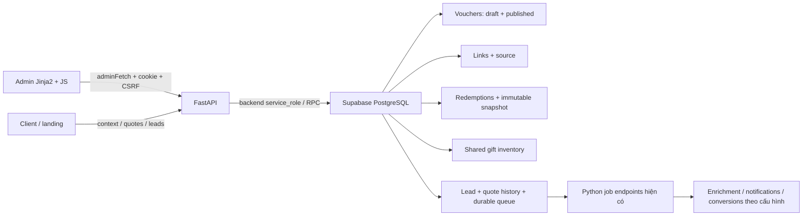
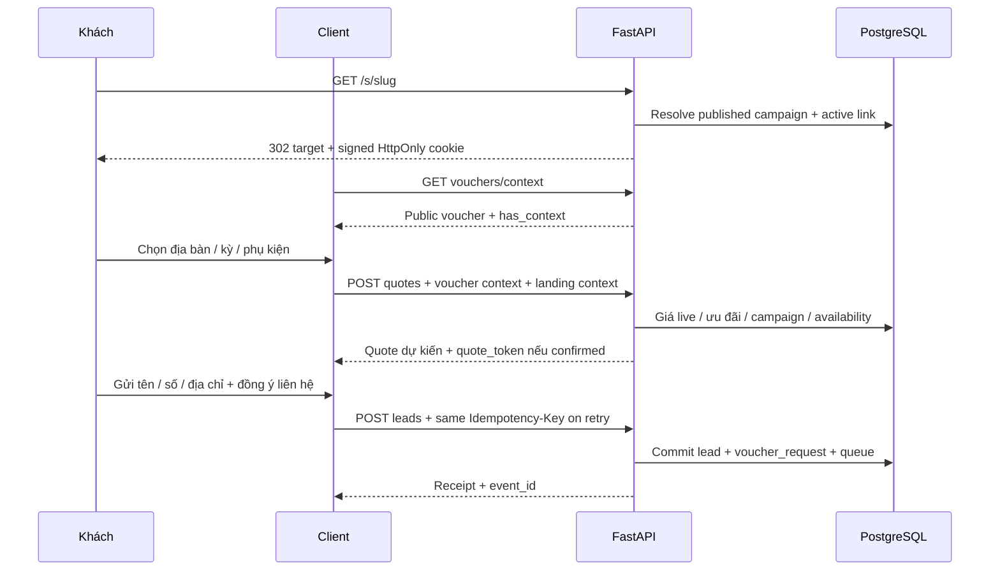

# Voucher: rà soát và luồng đấu nối cho Antigravity

Ngày rà soát: **13/10/2026** — phạm vi: voucher khu vực, link/QR, thẻ gói, form lead và CRM liên quan. Tài liệu cập nhật theo đợt sửa lỗi ngày 13/10/2026. Trạng thái triển khai và bằng chứng mới xem `../qa/2026-10-13/voucher-deep-audit.md`; không dùng điểm tham chiếu dưới đây làm cam kết đã kiểm chứng mọi môi trường.

Đọc kèm:
- `PROMPT-ANTIGRAVITY-VOUCHER.md`: prompt giao việc thiết kế.
- `voucher-ui-contract.json`: route và request schema trích từ ứng dụng hiện tại; response động cần đọc phần dưới.
- `../admin/VOUCHER-KHU-VUC.md`: quy trình vận hành.
- `../qa/2026-10-13/vouchers.md`: bằng chứng kiểm thử trước đó.

## 1. Kết quả kiểm tra và phần chưa đạt

Phân loại: **UI** = làm được với API hiện có; **BE** = cần nâng backend; **QA** = cần phép đo/kiểm chứng. P1 là ưu tiên trước khi đưa chiến dịch vào sử dụng rộng; P2 là nâng cấp sau. Các mục là khoảng trống/cải tiến, không đồng nghĩa mọi mục đều là lỗi runtime.

| Hạng mục, điểm tham chiếu | Kiểm tra thực tế | Công việc cần làm | Loại / ưu tiên |
|---|---|---|---|
| Điều kiện áp dụng — 9,0 | Có ưu tiên xã → tỉnh → toàn quốc và loại trừ. Preview chỉ mô tả, chưa giải thích quy tắc nào thắng trong một tình huống cụ thể. | Minh họa thứ tự ưu tiên; thêm mô phỏng có giải thích từ engine server. | UI + BE / P1 |
| Tính giá — 8,8 | Engine tính số nguyên, có trần. Đã chặn giảm đơn thuần với mức/trần 0; mức giảm thực tế bằng 0 và không có quà trả `no_benefit`. | Hiển thị lỗi cạnh trường và giải thích `no_benefit`; giữ validation server trước công bố. | UI + BE / P1 |
| Hạn mức/tồn kho — 9,0 | Chống oversell và hết hạn đã có test; GET inventory trả **tổng tồn kho**, chưa trả đủ số đang giữ/đã dùng/còn lại. | Dashboard capacity, cảnh báo gần cạn và thời gian giữ. Cần dữ liệu server để hiển thị số suất/quà còn thật. | BE + UI / P1 |
| Bảo mật — 8,5 | API kiểm tra quyền, MFA và scope; contact limit không chứng minh người dùng duy nhất. Intake đã có chống abuse theo phone/session/IP. | Giữ nguyên bảo vệ; kiểm tra bổ sung abuse cho context/quote/link và xác minh theo rủi ro nếu cần. Không thêm OTP đại trà chỉ vì thiết kế. | BE + QA / P2 |
| CRM — 8,5 | Có trạng thái, giữ/hủy/dùng; nhân viên vẫn phải tự hiểu các điều kiện trước thao tác. | Checklist: địa chỉ → gói/kỳ → trạng thái → giữ → nghiệm thu. Dẫn tới form đang có; hiển thị lý do nút bị khóa. | UI / P1 |
| Admin — 7,5 | Form dài; lỗi validation chủ yếu hiển thị chung. Tìm/sort chỉ trên các voucher đã tải; batch pause chạy từng request. | Wizard, lỗi cạnh trường, mẫu cấu hình, nhân bản qua POST create. Ghi “trong N mục đã tải”; tìm/sort toàn bộ cần server. | UI; BE cho tìm/sort / P1 |
| Client — 8,0 | Có cookie, nhập/bỏ mã, quote và tổng tiền. Phần benefit chưa có thiết kế ưu tiên rõ so với các thông tin khác. | Nhãn lợi ích gọn, tiền gói/tháng và tổng kỳ tách rõ, quà/thiết bị trả phí phân biệt, giữ form ba trường. | UI / P1 |
| Link/QR — 7,8 | Server đã kiểm tra trang đích công khai khi tạo link và khi chuyển hướng; trang không tồn tại/chưa công bố bị chặn. Slug không thể bị voucher khác ghi đè khi tạo đồng thời. List trả tối đa 500 link toàn hệ thống. Không có endpoint xóa link; tắt bằng `active=false`. | UI kiểm tra `/api/v1/pages/{slug}`; ba trang hệ thống `/`, `/khuyen-mai`, `/do-toc-do` hợp lệ. Phân trang link và version khi cùng sửa một link vẫn là cải tiến riêng. | UI + BE / P1 |
| Báo cáo — 6,8 | `/report` không nhận query ngày; có tổng/kênh/nhân viên/khu vực nhưng chưa có series thời gian hoặc doanh thu. | Biểu đồ nhóm từ dữ liệu thật hiện có; date filter/trend/ROI cần thêm hợp đồng backend. | UI + BE / P1–P2 |
| Hiệu năng — 6,8 | `voucher_live` đếm capacity theo từng rule; report tổng hợp trực tiếp; chưa có load test p95/p99. | EXPLAIN/đo tải với nhiều rule và nhiều redemption, phân trang phía server, giới hạn concurrency. Cache preview không thay kiểm tra capacity trong transaction. | BE + QA / P2 |
| Kiểm thử — 8,5 | Lượt trước toàn dự án 446 Python + 26 JS đạt. Lượt bàn giao này chạy lại 29 test voucher, đạt 14,48 giây. | Safari/iPhone thật, screen reader, staging/MFA thật, phục hồi và tải cao còn cần kiểm chứng. | QA / P1 |
| Production — 5,0 | Thiếu schema voucher production đã được xác định và bổ sung; kiểm chứng tạo bản nháp trong giao dịch rollback. Trạng thái migration sửa sâu và deploy xem báo cáo QA mới. | Kiểm tra Supabase đúng project, migration pending, deploy đồng bộ và smoke staging. | Vận hành / P1 |

### Các điểm cần sửa lại trong cách diễn giải dữ liệu

1. **Không vẽ sáu KPI thành phễu tuần tự.** `held` là số suất đang giữ hiện tại; `redeemed` là số đã dùng. Khi dùng, một suất rời `held`. `installed` đếm lead yêu cầu voucher đã lắp, kể cả không redeem; các số không nhất thiết giảm dần.
2. `eligible` trong report nghĩa là từng có redemption của chiến dịch, không phải số khách truy cập đủ điều kiện qua engine. Phần client `voucher.status=eligible` lại là kết quả báo giá dự kiến. Giao diện phải phân biệt hai ngữ cảnh này.
3. `cost_vnd` là chi phí voucher đã dùng: giảm tiền + giá vốn quà. Không phải doanh thu, tổng tiền khách đóng, ngân sách quảng cáo hoặc lợi nhuận.
4. `inventory.stock` là tổng số lượng được cấu hình. Không đổi nhãn thành “còn lại” và không trừ riêng từ report của một campaign: quà được chia sẻ giữa nhiều campaign.
5. Preview Admin hiện tại là bản tóm tắt **client-side**, không phải chứng nhận tính đúng/khả dụng của bản nháp.

Bằng chứng nguồn: `modules/vouchers/{schemas,engine,routes,service}.py`, `static/js/admin/vouchers.js`, `supabase/migrations/20261013030159_regional_vouchers.sql`. Kiểm tra schema/API local xác nhận: trần 0 được chấp nhận; report không có query parameters; chưa có route simulate/preview voucher; đường dẫn landing chưa tồn tại vẫn qua validator. Không thay đổi mã sản phẩm trong lượt bàn giao này.

## 2. Ranh giới thiết kế

**Làm được ngay bằng frontend:** wizard, tóm tắt điều kiện, preview nội dung, cảnh báo form, mẫu/nhân bản với mã mới, tự điền inventory đã có, biểu đồ tổng hợp, checklist CRM, tải CSV aggregate hiện có, kiểm tra trang đích công khai trước lưu, chỉnh responsive.

**Cần BE trước khi nút hoạt động:** mô phỏng bản nháp bằng engine, kiểm tra trang đích bắt buộc ở server, tìm/sort toàn bộ, phân trang link, optimistic version link, capacity thật cho dashboard, alert bền vững, lọc thời gian/trend, doanh thu/ROI và quy trình đảo giao dịch đã dùng.

Antigravity có thể thiết kế trạng thái tương lai riêng trong prototype, ghi **“Cần API bổ sung”**. Không làm nút giả báo thành công; không âm thầm gọi query chưa được hỗ trợ.

## 3. Kiến trúc và nguồn dữ liệu



- Stack giữ Python/FastAPI + Jinja2 + CSS/JS nhẹ. Không chuyển sang Next.js/Node, không tạo backend thứ hai.
- Browser chỉ gọi API ứng dụng cùng origin, không truy cập bảng private/RPC bằng service-role.
- Supabase là nguồn trạng thái, giá, quota và quyền. R2 là nguồn ảnh gói/phụ kiện hiện có. Voucher không có trường upload ảnh riêng.
- Một voucher có `payload` bản nháp, `published_payload` bản đang áp dụng, `version` phiên bản quản lý và `published_version` phiên bản snapshot live.
- Không suy ra “có thay đổi chưa công bố” chỉ từ `version != published_version`: công bố cũng tăng version. So sánh payload hoặc dùng trạng thái dirty của editor.
- Không cache chung ngữ cảnh cookie voucher hoặc dữ liệu Admin giữa các khách. Quote/server là nguồn cuối cùng cho giá.

## 4. Bản đồ API → thành phần giao diện

Các path sau là endpoint hiện có. Dynamic `{action}` chỉ nhận `redeem` hoặc `release`. JSON request gửi `Content-Type: application/json`.

| Thành phần | Method + path | Dữ liệu / xử lý |
|---|---|---|
| Quyền và phiên | GET `/api/v1/admin/me` | `id`, `aal`, memberships; dùng helper quyền hiện có |
| Danh sách voucher | GET `/api/v1/admin/vouchers?before=<uuid>` | `{items,links}`; mỗi trang 50 voucher, links tối đa 500; không có q/sort/status/date server |
| Tạo | POST `/api/v1/admin/vouchers` | Full `VoucherInput`; 201 → record |
| Sửa | PUT `/api/v1/admin/vouchers/{id}` | Full `VoucherUpdate`, gồm expected_version; không phải PATCH |
| Công bố/tạm dừng | POST `/api/v1/admin/vouchers/{id}/publish` hoặc `/pause` | `{expected_version}` → record mới |
| Xóa bản nháp | DELETE `/api/v1/admin/vouchers/{id}?expected_version=N` | Chỉ chưa từng công bố, chưa link/lịch sử; response JSON |
| Checkbox khu vực | GET `/api/v1/admin/vouchers/options` | `{provinces:[{id,code,name,wards:[{id,code,name}]}],source}` |
| Nhân viên nguồn | GET `/api/v1/admin/vouchers/employees` | `{items:[{id,name}]}`; tên có thể null |
| Tồn kho | GET/PUT `/api/v1/admin/vouchers/inventory` | GET `{items}`; PUT `{product_id,stock,cost_vnd,expected_version}`; version 0 khi tạo mới |
| Tạo/sửa/tắt link | POST `/api/v1/admin/vouchers/{id}/links` | `{slug,target,channel,employee_id,active}`; upsert theo slug; 201 |
| QR | GET `/api/v1/admin/vouchers/links/{slug}/qr` | SVG, cần phiên/quyền; không gọi dịch vụ QR ngoài |
| Báo cáo | GET `/api/v1/admin/vouchers/report` | `{totals,campaigns,channels,regions}`; không có filter ngày |
| Khách mở link | GET `/s/{slug}` | 302 + cookie HttpOnly → target; lỗi không khả dụng 404 |
| Đọc mã đang áp dụng | GET `/api/v1/vouchers/context` | `{voucher,has_context}`; voucher có thể null nhưng has_context=true |
| Khách nhập mã | POST `/api/v1/vouchers/context` | `{code}` → `{voucher}` và cookie; HTTP 200 + voucher=null vẫn là mã không khả dụng |
| Bỏ mã | DELETE `/api/v1/vouchers/context` | 204, không parse JSON; xóa cookie rồi refresh quote |
| Gói/phụ kiện công khai | GET `/api/v1/catalog`, `/api/v1/accessories` | `{items}` đã công bố; giữ `id`, giá và ảnh từ nguồn thật |
| Khu vực client | GET `/api/v1/regions/hierarchy`; `/api/v1/regions/{id}/wards?limit=100&before=<uuid>` | Giá chỉ dùng địa bàn đã công bố; tận dụng `regions.js`, tải thêm ward nếu có |
| Kiểm tra đích landing | GET `/api/v1/pages/{slug}` | Có thể dùng để kiểm tra trang công khai; không gọi cho `/`, `/khuyen-mai`, `/do-toc-do` |
| Báo giá | POST `/api/v1/quotes` | `QuoteRequest`; main quote có tổng tiền, token; option previews không có token |
| Gửi form | POST `/api/v1/leads` | `LeadRequest`, header Idempotency-Key; 201 hoặc replay 200; chỉ thành công khi có receipt/event_id |
| Đọc hồ sơ voucher | GET `/api/v1/admin/leads/{id}/voucher` | `{lead,request,deal,redemption}` |
| Giữ | POST `/api/v1/admin/leads/{id}/voucher/reserve` | `{code,billing_months,expected_version}` — dùng **lead.version** |
| Dùng/hủy | POST `/api/v1/admin/leads/{id}/voucher/redeem` hoặc `/release` | `{reason,expected_version}` — dùng **redemption.version** |
| Địa chỉ CRM | GET `/api/v1/admin/address-options`; thêm `?province_code=N` để lấy ward | `{items,source}`; code là số địa giới, khác UUID rule |
| Hồ sơ/xác nhận địa chỉ | GET/PUT `/api/v1/admin/leads/{id}/profile` | GET `{lead,pii}`; PUT `ProfileInput`; phone không có trong body sửa |
| Gói đã chốt | GET/PUT `/api/v1/admin/leads/{id}/billing` | GET `{deal}`; PUT `DealSave`; version là **deal.version**, 0 khi chưa có deal |
| Trạng thái lead | POST `/api/v1/admin/leads/{id}/transitions` | `TransitionCommand`, đúng workflow, lý do/thông tin nghiệm thu khi cần |
| Xác nhận quote | POST `/api/v1/admin/leads/{id}/quotes/confirm` | `{quote_token,expected_version}`; giữ voucher thì cần hủy trước |

Backend hiện có không khai báo response_model đầy đủ cho nhiều response động. Không suy luận shape từ `{}` trong OpenAPI; dùng mục response và SQL/RPC dưới đây.

## 5. Quyền, phiên và lỗi

| Thao tác | Quyền bắt buộc |
|---|---|
| Trang voucher/list/create/update/link/report/options/employees | `marketing.write` toàn hệ thống |
| Publish/pause/delete/inventory PUT | Thêm `pricing.publish`, `aal2` |
| Inventory GET, QR | `marketing.write` |
| Voucher CRM read/reserve/redeem/release | `lead.write`, scope/assignment do database kiểm tra |
| Profile GET/PUT | `lead.write` + `lead.pii` + `aal2`, đúng scope |
| Address options | `lead.write` |
| Billing GET / PUT | GET `lead.read`; PUT `lead.write` + `aal2`, đúng scope |
| Assignment | `lead.assign`, đúng phạm vi nhân viên |

- `adminFetch()` trong `static/js/admin/auth.js` tự dùng cookie HttpOnly và thêm `X-CSRF-Token` từ cookie `pagefpt_csrf` cho method thay đổi dữ liệu.
- Không lưu JWT, service-role, PII, mã MFA vào localStorage. Không dựng luồng login/MFA mới trong chức năng voucher.
- 401 → luồng đăng nhập hiện có. 403 → thông báo cần quyền/MFA; không lặp gọi hoặc dùng khóa server để vượt quyền.
- Mutation phải chờ response và đọc record/version mới. Khóa double-submit; giữ bản nhập nếu thất bại.
- `VERSION_CONFLICT`: tải lại dữ liệu, cho người dùng so sánh bản nháp; không ghi đè bằng version mới một cách tự động.
- Error envelope: `{code,message,fields,request_id}`. `message` có thể chung “Request cannot be completed”; UI map `code`, dùng `fields` cho inline error và cung cấp request_id để hỗ trợ.

Mapping cần có:

| Mã | Hành động UI |
|---|---|
| VALIDATION_ERROR | Liên kết lỗi `body.<field>` hoặc `body.rules.N.<field>` tới trường; focus error summary |
| VOUCHER_CODE_EXISTS / VOUCHER_CODE_IMMUTABLE | Chọn mã mới / giữ mã cũ |
| VOUCHER_ARCHIVE_REQUIRED | Chỉ cho tạm dừng, giữ lịch sử |
| INVALID_GIFT / INVALID_ACCESSORY | Tải lại phụ kiện và kiểm tra gói/dịch vụ/tồn kho |
| VOUCHER_LIMIT_BELOW_COMMITTED / INVENTORY_BELOW_COMMITTED | Giải thích đang có suất/quà đã cam kết; không tự hạ hạn mức |
| VOUCHER_ADDRESS_REQUIRED / VOUCHER_CLOSE_REQUIRED | Dẫn tới bước xác nhận địa chỉ/gói hoặc báo giá |
| VOUCHER_NOT_ELIGIBLE | Giải thích gói/kỳ/địa bàn chưa phù hợp |
| VOUCHER_QUOTA_EXCEEDED / VOUCHER_REGION_QUOTA_EXCEEDED | Hết suất chiến dịch/khu vực |
| VOUCHER_BUDGET_EXCEEDED / VOUCHER_GIFT_SOLD_OUT / VOUCHER_CUSTOMER_LIMIT | Hết ngân sách/quà hoặc đạt hạn mức contact |
| VOUCHER_RELEASE_BEFORE_EDIT / VOUCHER_ALREADY_HELD | Yêu cầu hủy suất hiện có trước; xác nhận tác động |
| QUOTE_STALE / VOUCHER_SCOPE_CHANGED | Tính lại giá, đồng bộ profile với deal; không sửa tiền ở browser |
| VOUCHER_HOLD_EXPIRED / VOUCHER_REDEMPTION_CONDITION | Giữ lại nếu còn suất / hoàn thành chốt hoặc lắp đặt |
| RATE_LIMITED / CHALLENGE_REQUIRED | Giữ form, dùng hướng dẫn xác minh/chờ hiện có |
| DATABASE_UNAVAILABLE / SESSION_REFRESH_BUSY | Retry có giới hạn; giữ bản nhập và không báo thành công |

## 6. DTO và đơn vị

Schema đầy đủ, required/default/enum/giới hạn nằm trong `voucher-ui-contract.json`. Các nguyên tắc bắt buộc:

- **VND**: số nguyên; `%` trên UI → BPS: `5%` gửi `amount=500`. Fixed amount gửi số VND. `%` bắt buộc `cap_vnd`.
- **Ngày**: hiển thị `dd/mm/yyyy`, thời gian theo Việt Nam; API ISO 8601 có timezone. Dùng `PageFPTDates`; không gửi chuỗi dd/mm/yyyy vào trường datetime API. Không format lại thành mm/dd/yyyy.
- **Địa bàn voucher/client**: `region_id` UUID. **Xác nhận địa chỉ CRM**: `province_code`, `ward_code` integer. Không hoán đổi hai loại ID.
- `rules`: 1–200, key và region_id không trùng, chỉ một default `region_id=null`; exclusions tối đa 200. Plan IDs tối đa 100; dịch vụ là internet/combo/camera/business/play.
- Chọn cả plan và service là điều kiện AND; để trống plan_ids nghĩa mọi gói đáp ứng điều kiện khác.
- Một rule có amount > 0 hoặc gift_product_id. Gift phải là phụ kiện public, one_time, hợp gói/dịch vụ và đã cấu hình inventory.
- `billing_months` của voucher chỉ 1/6/12; quote chung chấp nhận 1–36. Giao diện voucher giữ đúng ba kỳ.
- Mã voucher uppercase 3–40 `[A-Z0-9_-]`, bất biến sau tạo. Slug link lowercase 3–50 `[a-z0-9-]`.
- PUT voucher gửi full config, không gửi `id/status/version/published_payload` ở body. Chỉ thêm `expected_version`.
- Các DTO dùng `extra=forbid`. **LeadRequest không có field `billing_months`**. Giữ kỳ qua quote_token và notes theo `bottom_sheet.js`; muốn thêm field riêng cần sửa hợp đồng backend.
- Inventory `stock`/`cost_vnd` khác product `price_vnd`/`original_price_vnd`; không gán giá bán vào giá vốn.

Ví dụ tạo chỉ minh họa cấu trúc, không phải chính sách thương mại thật:

```json
{
  "code": "MA-DO-ADMIN-NHAP",
  "name": "Tên chiến dịch do Admin thiết lập",
  "label": "Nhãn do Admin thiết lập",
  "terms": "Điều kiện được chủ hệ thống xác nhận",
  "start": "2026-11-01T00:00:00+07:00",
  "end": "2026-11-30T23:59:00+07:00",
  "plan_ids": [], "services": [], "billing_months": [1,6,12],
  "rules": [{"key":"default","region_id":null,"region_name":"Toàn quốc","discount_kind":"fixed","amount":100000,"basis":"initial","cap_vnd":null,"quota":null,"gift_product_id":null}],
  "exclusions": [], "quota":10, "per_contact_limit":1,
  "budget_vnd":1000000, "hold_hours":48,
  "redeem_at":"installed", "stackable":false
}
```

## 7. Luồng Admin: cấu hình → công bố → chia sẻ

1. Nạp `/me`, list, catalog, accessories, options, employees, inventory và report. Các lookup độc lập có thể song song; lookup lỗi phải có retry, không biến “chưa tải được” thành “không có dữ liệu”.
2. Wizard ba bước: **Ưu đãi → Gói & địa bàn → Thời hạn & kiểm tra**. Đây là view của cùng một state; đổi bước không mất values/rules/exclusions. Advanced giữ contact limit, hold_hours, stacking và redeem_at.
3. Preview nội dung dùng draft, gắn “Chưa công bố”. Không sửa payload live khi gõ. Bản mô phỏng tiền draft bằng server chưa có API.
4. Create POST / update PUT; nhận record/version. Publish chỉ sau lưu thành công, đủ quyền/MFA. Sau publish reload list/report; use record mới.
5. Nhân bản: đọc payload từ record đã tải, tạo local copy, yêu cầu mã mới, gọi POST create. Không sao chép id/version/live/history hoặc tự công bố.
6. Share dùng record.id; giữ slug/channel/employee/active. Tắt link POST cùng slug + active=false. Kiểm tra target public là tiện ích UI, không thay validation server.
7. Copy URL và QR phải cùng origin chuẩn. Backend QR dùng `PAGEFPT_PUBLIC_ORIGIN` khi được cấu hình; frontend hiện dùng location.origin. Trong production cần thống nhất origin khi mở bằng alias Vercel.
8. Bulk pause gọi endpoint pause từng record có version; ghi kết quả thành công/thất bại từng mục. Không gọi endpoint `/bulk` voucher tưởng tượng.

## 8. Luồng client: link/mã → giá → form



- `PageFPTVoucher.quoteContext()` cung cấp voucher_code; `.leadContext()` thêm voucher_link khi có; không đọc cookie HttpOnly bằng JS.
- GET context voucher có `id,code,name,label,terms,start,end,status,sold_out,link` khi tương ứng. Không có giá vốn, budget, số lượt truy cập hoặc số suất còn cụ thể.
- POST context có thể trả `{voucher:null}` với HTTP 200. GET `has_context=true` vẫn cần nút Bỏ mã khi campaign paused/expired. DELETE 204 xong refresh quote/catalog/form.
- Mở link mới thay context cũ. Mã explicit khác campaign không tự thừa kế source link cũ. `voucher_code:""` là chủ động bỏ fallback.
- `POST quotes` body: `{plan_id,region_id,billing_months,accessory_ids,landing_slug?,voucher_code?}`. Khi thay một lựa chọn, request mới được tính server; abort/fence phản hồi cũ.
- `quote.status`: confirmed / needs_confirmation / not_available. Không có giá phù hợp thì “Cần tư vấn”, không 0đ, không giá thấp nhất vùng khác.
- Quote main gồm `monthly_vnd`, `billing_months`, `initial_total_vnd`, `line_items`, `accessory_snapshot`, `accessory_once_vnd`, `accessory_monthly_vnd`, `revision`, `expires_at`, `quote_token` khi confirmed, và voucher khi có.
- `voucher.status`: eligible/address_required/area_excluded/area_mismatch/plan_mismatch/term_mismatch/promotion_conflict/sold_out/expired/not_started/gift_unavailable/gift_incompatible/gift_selected/no_benefit/unavailable.
- Eligible là ưu đãi **dự kiến**, chưa giữ suất. Banner/name/label không được hiểu là đã được nhận quà.
- `discount_vnd` là tổng giảm của lần thanh toán/kỳ. Với basis=monthly, số này đã nhân số tháng, không phải giảm mỗi tháng; monthly_vnd đã điều chỉnh.
- `initial_total_vnd` là tổng theo lựa chọn hiện tại. Không cộng thêm accessory/voucher lần nữa vào giá server.
- `billing_options` 1/6/12 là preview không có quote_token, đã gồm phụ kiện được chọn và điều kiện quà trùng thiết bị. Đổi kỳ vẫn phải lấy main quote mới để dùng token. Khi đổi checkbox, browser bỏ quote voucher có `accessory_ids` không khớp ngay; không tái dùng ưu đãi cũ trong khi chờ request hoặc khi request lỗi.
- Gift trùng phụ kiện khách mua → gift_selected; yêu cầu bỏ chọn rõ ràng, không âm thầm xóa thiết bị hoặc tự tính free.
- Giữ form Tên/Số/Địa chỉ cụ thể; consent liên hệ và phân tích riêng theo luồng có sẵn. Không buộc nhập mã/chọn ward để gửi lead.
- `submitLeadToBackend()` giữ body/key khi kết quả commit chưa rõ; đừng đổi thành request mới mỗi retry. Success chỉ sau receipt/event_id thật. Không gửi billing_months ngoài schema, tiền client, contact_id hoặc source tự dựng.
- Không bật thêm analytics khi khách từ chối; không gửi phone/name/address/IP vào GA4, URL, QR hay browser logging.

## 9. Luồng nhân viên: xác nhận → giữ → dùng/hủy

1. GET voucher panel cùng detail. `request` là intent intake: code, voucher_id, version, status, link_slug, source. `deal` có plan_id/billing_months đã chốt. `redemption` là lịch sử/suất hiện tại; `contact_id` đã bị bỏ khỏi API này.
2. Xác nhận địa chỉ bằng profile GET/PUT và address-options: province_code → ward_code → địa chỉ cụ thể. Phone read-only. Profile backend ghi address_confirmation và UUID region_candidate; không tự tạo field confirmed_by từ UI.
3. Gói trong profile và deal cần khớp. Nếu cần chốt kỳ/gói, dùng billing GET/PUT, không chỉ đổi select trong voucher panel.
4. Cho biết trạng thái lead phù hợp: quoted/closed/installed. Transition đúng workflow hiện có; không tự nhảy installed để redeem.
5. Reserve gửi code/kỳ + lead.version; server tính lại giá theo địa chỉ xác nhận, kiểm tra deal/scope, khóa contact → lead → redemption → campaign → inventory → catalog để commit capacity/snapshot.
6. Reload detail **một lần** sau success; panel load nằm trong `initLeadDetail()`. Không vừa load panel vừa init detail hai lần. Giữ input nếu error; fence response theo leadId/generation.
7. Held panel: tên/code, mức giảm/quà, kỳ, tổng, expires_at; hai action Dùng/Hủy cần reason ≥3 ký tự và redemption.version. Default dùng khi installed; closed chỉ khi cấu hình cho phép.
8. Release làm quote_status cần xác nhận lại, trả capacity. Expiry cũng trả capacity, UI hiển thị expired. Redeemed là lịch sử, không có API undo/refund; không dựng nút Hoàn suất đã dùng.
9. Snapshot immutable: khi đang held phải release trước sửa profile, gói/kỳ deal hay confirm quote khác. Pause campaign không hủy snapshot đã giữ.
10. Nhân viên được gắn vào link là **nguồn giới thiệu**, không tự động là người được phân công lead. Assignment là quy trình riêng; không gán assignee_id từ link ở frontend.

## 10. Đấu nối báo cáo

`report.totals`: requested, eligible, held, redeemed, installed, cost_vnd.

- `campaigns[]`: thêm id/code/name.
- `channels[]`: thêm channel/employee_id (có thể null).
- `regions[]`: thêm voucher_id/rule_key. `pending_address` = chưa có rule giữ; dùng tên quy tắc nếu có trong campaign đã tải, fallback có nghĩa khi chưa tải.
- Rỗng → “Chưa có yêu cầu ưu đãi”, CTA tạo/chia sẻ; lỗi → retry; loading → skeleton; không dùng số ngẫu nhiên.
- Có thể render bar chart nhóm và bảng có cùng số liệu; có thể tính tỉ lệ redeemed/requested nếu mẫu >0, ghi “trên yêu cầu”, không gọi đó là conversion toàn website.
- Không dùng requested làm “người đang xem”, không dùng totals tất cả thời gian cho bộ lọc “7 ngày”. Không làm trend bằng cách tự chia số tổng theo ngày.
- CSV aggregate client-side có thể dùng dataset report đang tải; không xuất PII và không gọi đây là export lịch sử giao dịch chi tiết.

## 11. File và hook cần giữ tương thích

| File / hook | Trách nhiệm |
|---|---|
| `templates/admin/vouchers.html` | Trang thiết lập mới, IDs bindings và base layout |
| `static/js/admin/vouchers.js` | Editor/list/link/inventory/report; giữ DTO, version và error semantics |
| `static/css/vouchers.css` | Style Admin/client/CRM; scope class để không ảnh hưởng toàn trang |
| `static/js/admin/auth.js`, `common.js` | Phiên, CSRF, quyền, helpers; không tạo auth thứ hai |
| `static/js/admin/lead_voucher.js` | Panel trong detail; `window.loadLeadVoucher` |
| `templates/admin/leads/detail.html` | `currentLead`, `initLeadDetail`, panel, quote money/period |
| `static/js/admin/profile.js`, `billing.js` | Xác nhận địa chỉ/gói chốt; giữ PII trong memory |
| `static/js/admin/list_tools.js` | Generic enhancer; bảng tự quản giữ `data-managed-list="true"` |
| `static/js/client/vouchers.js` | Context/banner, `PageFPTVoucher.quoteContext/leadContext/summary` |
| `static/js/client/accessories.js` | `PageFPTAccessories.ids/term/current/refresh/acceptQuote/clearQuotes`; kỳ/phụ kiện và quote |
| `static/js/client/catalog.js`, `bottom_sheet.js`, `api.js` | Giá/CTA/form, `refreshCatalogPrices`, `refreshActiveQuote`, `openBottomSheet`, `submitLeadToBackend` |
| `static/js/client/regions.js` | `getSelectedRegionId/getSelectedRegionPath`; explicit selection thắng gợi ý IP |
| `templates/layouts/client_base.html`, `client/telecom_landing.html` | Client chung và standalone; load dates/context đúng thứ tự; preview không gửi lead |
| `static/js/dates_vn.js` | `PageFPTDates`: display dd/mm/yyyy, serialize API |

Nếu đổi IDs/data attributes, cập nhật tất cả selectors, listeners và browser test cùng lúc. Không giữ hai listener submit, hai voucher banner hoặc hai bộ quote state.

## 12. Tiêu chí nghiệm thu thiết kế

- 320/360/390/430/768/1024/1440px, portrait/landscape; không tràn viewport hoặc ép mất chữ. Bảng dài chỉ cuộn trong vùng bảng.
- Wizard có quay lại/tiếp tục, giữ state; advanced không làm mất trường trong full PUT. Desktop preview bên cạnh, mobile mở theo yêu cầu.
- Touch controls ưu tiên 44px; focus rõ, keyboard Tab/Enter/Space/Escape; labels thật, aria-live, aria-invalid và error-summary.
- Font input mobile dễ đọc; không scale toàn trang để ép vừa màn hình. Hỗ trợ tăng cỡ chữ và reduced-motion.
- Các trạng thái thiếu quyền, MFA, loading, empty, failed, paused, expired, hết suất/quà/ngân sách, quote stale, version conflict đều có thiết kế và lời giải thích.
- Thẻ gói đồng bộ kích thước trong nhóm, banner/ảnh không biến dạng; nội dung dài xử lý bằng vùng hợp lý, không che tiền/CTA.
- Dùng server quote, không bịa giá, stock, số người xem hoặc countdown. Countdown chiến dịch chỉ từ end thật và không thay eligibility server.
- Chạy lại voucher tests, browser voucher/reference_cards/landing_studio/home_mobile và JS contracts tương ứng với thay đổi. Kiểm thử môi trường thật tách riêng, không gửi notification/conversion QA ra tài khoản thật.

## 13. Hạng mục backend để bàn giao tiếp

Đây là đề xuất hợp đồng tương lai, **chưa phải endpoint hiện có**. Trước khi implement cần thống nhất schema, quyền và tests:

1. Mô phỏng full draft qua engine server, không ghi lead/quote history/giữ suất; trả quy tắc thắng, reasons và breakdown.
2. Validate link target published ở server; list link theo campaign có cursor; expected_version để tránh ghi đè.
3. List voucher server q/status/sort/direction/cursor, sort ổn định theo value + id; query giới hạn và phù hợp index.
4. Admin capacity theo campaign/rule/gift: configured/held/redeemed/available/budget committed, as_of; không public hóa giá vốn.
5. Report time range/timezone/granularity với định nghĩa cohort và cost rõ; series không trộn stock hiện tại với event counts. Revenue/ROI chỉ khi có nguồn thu thực đã đối soát.
6. Alert qua queue + dedupe/idempotency; chưa gửi Telegram/SMS/email từ frontend. Kiểm thử tải và cảnh báo đạt ngưỡng chỉ sau phép đo.

Không coi các đề xuất này là đã triển khai chỉ vì có màn hình thiết kế.

## Bổ sung sau rà soát sâu 13/10/2026

- Context POST/DELETE được xếp hàng để cookie và mã hiển thị không lệch khi bấm Bỏ mã rồi nhập mã mới. Render dùng generation; không dựng thêm listener bỏ qua hàng đợi này.
- Tên chiến dịch/quà/địa chỉ ước tính được đưa vào DOM bằng textContent; không nhúng HTML từ dữ liệu nhập. CSV escape dấu nháy và trung hòa ô công thức.
- Giữ voucher dựa trên slug landing trong quote đã lưu ở server. Giá chiến dịch được tính lại và publication/version được xác nhận trong transaction. `QUOTE_STALE` cần lấy báo giá mới; không lấy giá client gửi.
- Quà phải là phụ kiện đã công bố, tính một lần. Đổi sản phẩm thành phí theo tháng khiến quà chưa giữ không còn hợp lệ.
- Xóa PII không hoàn tồn kho/quota/ngân sách đã dùng. Ledger đã dùng được ẩn danh, không còn lead/contact/link/lý do/quote token/địa chỉ. Suất đang giữ được giải phóng.
- Báo cáo nhóm `erased` giữ chi phí/suất đã dùng, không giữ nguồn hay nhân viên của khách đã xóa. `requested` ở nhóm này là lịch sử sử dụng ưu đãi ẩn danh, không phải lead đang tồn tại hoặc lượt mở link. Tổng không phải funnel sự kiện đầy đủ cho khách đổi nhiều chiến dịch.
- Lỗi mới: `INVALID_LINK_TARGET` (422), `INVALID_VOUCHER_BENEFIT` (422), `LINK_SLUG_EXISTS`/`VOUCHER_CODE_EXISTS` (409). HTTP 200 context với voucher=null vẫn là mã không áp dụng, không báo thành công.
