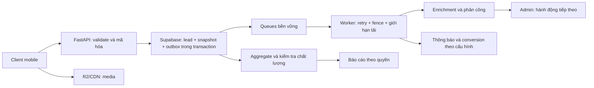

# Rà soát PageFPT: vận hành lớn, dữ liệu, thuật toán và trải nghiệm

Ngày đánh giá: **10/10/2026**. Đối tượng: mã nguồn hiện có trong workspace PageFPT, toàn bộ migrations, bộ kiểm thử và các luồng Client/Admin chính. Stack giữ nguyên Python/FastAPI, Jinja2, JavaScript nhẹ, Vercel, Supabase, Cloudflare R2.

## 1. Kết luận quản trị

**Dự án có nền tảng nghiệp vụ khá đầy đủ, nhưng chưa đủ bằng chứng để xếp vào hệ thống vận hành quy mô lớn hoặc hệ thống dự đoán bằng dữ liệu đã được kiểm định.** Điểm mạnh là tính đúng đắn của tiếp nhận lead, báo giá, phân quyền và xử lý bất đồng bộ. Điểm yếu lớn nhất là truy vấn theo quyền ở dữ liệu lớn, tiến độ xử lý lịch quá hạn, chất lượng tín hiệu phục vụ chấm điểm, và giao diện chưa dẫn người vận hành tới công việc tiếp theo đủ rõ.

Ưu tiên đầu tư: **độ đúng của dữ liệu → vận hành ổn định → giao diện dẫn dắt → tối ưu chuyển đổi → mô hình học máy**. Tăng số biểu đồ hoặc thêm AI trước khi sửa các khoảng trống dưới đây sẽ tạo cảm giác chuyên nghiệp nhưng chưa cải thiện hiệu quả xử lý.

Điểm tham khảo dưới đây là nhận định chuyên môn về mức hoàn thiện hiện tại, không phải chứng nhận, số đo hiệu suất hay tỷ lệ chuyển đổi. Chưa có dữ liệu production tương ứng thì ghi rõ chưa xác minh.

| Hạng mục | Điểm /10 | Cơ sở và giới hạn |
|---|---:|---|
| Kiến trúc và ranh giới module | 8 | FastAPI theo module, gateway tập trung, worker bền vững; SQL dispatcher và một số JS editor còn lớn |
| Tiếp nhận và xử lý lead | 8 | Idempotency, mã hóa, lịch sử, phân công, version; thiếu bàn làm việc ưu tiên theo hành động |
| Gói, giá, phụ kiện, địa bàn | 8,5 | Kỳ hạn, hệ số, VAT, giá khu vực, snapshot và giá landing; cần mô phỏng ma trận và kiểm tra cấu hình trước công bố |
| Bảo mật ở mức mã nguồn | 8 | MFA, session HttpOnly, CSRF, scope, PII có kiểm soát; chưa thay thế kiểm toán hạ tầng hoặc kiểm thử xâm nhập |
| Tùy chỉnh Client/landing | 8 | Slide, menu, danh mục, nhãn, giá, liên hệ, footer, preview; là cấu hình theo mẫu có giới hạn |
| Trải nghiệm Client mobile | 7 | Form ngắn và bố cục đã có kiểm tra; trang chủ còn nhiều khối, cần đo hiệu quả thực |
| Trải nghiệm Admin | 6,5 | Chức năng phong phú nhưng thông tin dài, chưa có quy trình hành động thống nhất cho từng vai trò |
| Đo lường và phân tích | 6 | Có GA4, sự kiện nội bộ, cohort, chi phí; thiếu một số điểm đo và xác nhận cấu hình GA/Ads |
| Thuật toán hỗ trợ quyết định | 4,5 | Quy tắc có giải thích, suy giảm theo thời gian; chưa hiệu chỉnh xác suất hoặc đo chất lượng dự đoán |
| Sẵn sàng cho dữ liệu lớn | 4,5 | Có pagination, queue và index; phép thử 100.000 lead tái hiện truy vấn chậm và cảnh báo quá hạn bị kẹt |
| Kiểm chứng và chống tái phát | 8 | 386 bài Python, 22 kiểm tra JS đạt; CI chưa chạy hết JS và browser, thiếu ca dữ liệu lớn |
| Năng lực production thực tế | Chưa xác minh | Chưa đo cold start, RTT PostgREST, tải hỗn hợp, quota, khôi phục backup và lỗi vendor thật trong đợt này |

## 2. Phạm vi và bằng chứng mới

- Chạy toàn bộ `pytest -q` với PostgreSQL disposable, bỏ biến DSN ngoài môi trường: **386 passed, 104,64 giây**. Fixture áp dụng toàn bộ migrations hiện tại; tài khoản và dữ liệu đều giả.
- Chạy **22/22** file JavaScript contract trong `tests/contracts/*.mjs`: đạt.
- `ruff check src tests`: đạt. `mypy src`: đạt trên **101 source files**. Kiểm tra ranh giới kiến trúc: đạt.
- Chromium local kiểm tra **15 trang × 4 chiều rộng = 60 lượt** tại 360, 390, 768, 1440 CSS px: không tràn chiều ngang toàn trang, không thấy trường nhập đang hiển thị thiếu tên truy cập, không thấy gạch chân menu sidebar, không có lỗi JavaScript runtime trong các lượt đó.
- Đã xem ảnh chụp trang chủ, dashboard và bảng giá mobile. Dashboard dài; bộ lọc và KPI xếp dọc nhiều, làm chậm việc tiếp cận hành động chính.
- Probe SQL mới với **100.000 lead giả**, tất cả migrations hiện tại: danh sách có phân quyền chi nhánh trả 31 hồ sơ, trung vị **4.807,687 ms** qua 5 lần đo; báo cáo 10.000 hồ sơ trong scope khoảng **652,869 ms** trong một lần đo.
- Ba lượt `schedule_tick` với 100.000 hồ sơ đã quá hạn: số audit `sla.overdue` lần lượt **50 → 50 → 50**.
- Đọc AST tìm được **149 khai báo route decorator trong 32 file**. Đây là thống kê cấu trúc, không phải 149 chức năng độc lập hay bảo đảm đã bấm thử mọi endpoint.

Các lượt browser dùng SQL thật local và Auth mô phỏng; chặn request ra bên ngoài. Vì vậy không xác nhận phép đo mạng Cloudflare/RIPE thật, Google nhận event, Telegram gửi thật, R2 thật hoặc Auth Supabase hosted. Chưa chạy toàn bộ browser suite, mọi dialog, WebKit, đo tương phản hoặc trình đọc màn hình trong đợt này. Danh sách rủi ro dưới đây phân biệt **đã tái hiện**, **đọc mã xác nhận**, và **cần kiểm chứng môi trường**.

Bằng chứng tổng hợp: [audit-evidence.json](/mnt/DATA/Workspace/PageFPT/docs/reviews/2026-10-10-project-audit-evidence.json). Harness và ảnh nằm trong `.local/qa/project-audit-2026-10-10/`; dữ liệu giả không được gửi tới cloud.

## 3. Những việc phải xử lý trước khi tăng tải

### P1-01 — Danh sách theo quyền chậm khi hồ sơ của chi nhánh nằm sâu trong dữ liệu

**Đã tái hiện.** Dataset cố ý đặt 90.000 hồ sơ mới hơn ở các chi nhánh khác và 10.000 hồ sơ của actor ở phía sau. RPC thực tế mất 4,73–4,85 giây để trả 31 hồ sơ. Gateway đang dành **2 giây** cho phần lớn RPC; tình huống này vượt ngân sách và có nguy cơ trả `DATABASE_UNAVAILABLE`/503. Đây là phép đo local, chưa phải sự cố production được xác nhận.

[Truy vấn hiện hành](/mnt/DATA/Workspace/PageFPT/supabase/migrations/20261002080000_admin_quality.sql:145) dùng `private.can_read_lead(actor,ll)` trong điều kiện từng dòng, thêm joins và bộ lọc tùy chọn. Hướng điều tra chính là thiếu predicate scope đủ rõ để planner giới hạn dữ liệu sớm. Có index không tự bảo đảm RPC sử dụng hiệu quả. EXPLAIN của truy vấn đơn giản trong probe còn đọc `lead_created` rồi loại **90.000 dòng**; đây không phải EXPLAIN của toàn bộ RPC và không đủ để quy toàn bộ 4,8 giây cho index đó.

Đề xuất:

1. Tách đường truy vấn toàn hệ thống, chi nhánh được phép, và chỉ hồ sơ được phân công; tính scope một lần. Giữ kiểm tra quyền cuối cùng.
2. Scope ở chi nhánh hoặc assignee thành predicate trực tiếp; thử `UNION` các nhánh quyền khi cần, loại trùng ID trước pagination.
3. Giữ cursor `(created_at,id)`. Với sort mới, cursor phải chứa khóa sort, ID, actor và bộ lọc; whitelist tên cột.
4. Kiểm tra cả EXPLAIN RPC/nested statements, buffers, tỷ lệ dòng bị loại và các biến thể search/status/date; không tăng timeout làm biện pháp chính.

Nghiệm thu đề xuất: dataset lệch 100.000 và 1.000.000 hồ sơ; actor toàn cục/chi nhánh/nhân viên; query phải trả đúng scope, đúng thứ tự, không trùng trang, p95 nằm trong ngân sách đã chọn. Benchmark cũ trong `docs/backend/performance-results.md` không đủ thay thế phép thử này.

### P1-02 — Cảnh báo SLA bị giới hạn mãi ở 50 hồ sơ đầu

**Đã tái hiện.** [Scheduler](/mnt/DATA/Workspace/PageFPT/supabase/migrations/20261001014824_sessions_and_crm_completion.sql:414) chọn 50 hồ sơ quá hạn trước, rồi mới kiểm tra hồ sơ đã có audit. Những hồ sơ đã ghi cảnh báo vẫn tiếp tục chiếm 50 vị trí, nên các hồ sơ phía sau không được ghi cảnh báo trong các tick tiếp theo khi tập đầu không đổi.

Đưa điều kiện “chưa được xử lý cho lần đến hạn này” vào query **trước LIMIT**; khóa/idempotency theo `(lead_id,sla_due_at)` hoặc mã chu kỳ SLA, không chỉ theo lead vĩnh viễn. Có index hỗ trợ, xử lý cạnh tranh nhiều worker và lưu checkpoint nếu cần. Không bỏ LIMIT và quét toàn bảng.

Nghiệm thu: 120 hồ sơ quá hạn → các lượt 50/50/20; lần thứ tư không tạo trùng; đổi hạn tạo chu kỳ mới; hai scheduler cùng chạy không ghi hai cảnh báo. Lỗi này liên quan audit/cơ chế phát hiện quá hạn; **biểu đồ đếm hồ sơ quá hạn hiện dùng query riêng**, không được suy rằng biểu đồ cũng chỉ đếm 50.

### P1-03 — Điểm rủi ro 0 có thể bị hiểu nhầm là “đã kiểm tra, an toàn”

**Đọc mã xác nhận.** [Scoring](/mnt/DATA/Workspace/PageFPT/src/pagefpt/modules/intelligence/scoring.py:12) có các trọng số honeypot/burst/automation/impossible sequence, nhưng [worker enrichment](/mnt/DATA/Workspace/PageFPT/src/pagefpt/modules/workflow/worker.py:77) chưa truyền các tín hiệu đó vào evidence. Chống spam intake vẫn có bucket/challenge; vấn đề là dữ liệu đó chưa nối tới điểm rủi ro.

Đề xuất `risk_status=unknown|evaluated`, danh sách tín hiệu thực sự đã kiểm tra, thời điểm và nguồn. Không lấy 0 khi thiếu evidence làm “rủi ro thấp”. Chuẩn hóa observation từ rate bucket, challenge và lỗi trình tự; không chặn khách chỉ vì chung IP/VPN. Đánh giá false positive trên khách thật trước khi tự động từ chối.

### P2-01 — NLP đọc sai nhu cầu phủ định

**Đã tái hiện.** [Hàm đọc ghi chú](/mnt/DATA/Workspace/PageFPT/src/pagefpt/modules/intelligence/nlp.py:5) đọc “Không cần camera, chỉ cần internet” thành cả camera và internet; “Nhà không có 3 tầng” vẫn thành floors=3. Regex đang chỉ nhận sự xuất hiện từ/số.

Nâng cấp nhận diện phủ định, câu hỏi, giả định, nhu cầu hiện tại và thay đổi theo thời gian. Trả `{value,polarity,status,evidence_span,source_version}`; câu mâu thuẫn phải `needs_review`. Cho nhân viên xác nhận trước khi gợi ý thiết bị hoặc dùng làm feature huấn luyện. LLM chỉ là bước tùy chọn sau rules, chạy queue với JSON schema, dữ liệu tối thiểu và cơ chế chấp thuận nhà cung cấp; không đặt vào request gửi lead.

### P2-02 — Thiếu điểm đo thẻ gói trên trang speedtest

**Đọc mã xác nhận.** [Observer GA](/mnt/DATA/Workspace/PageFPT/src/pagefpt/static/js/client/google_analytics.js:149) nhận `.plan-card`/`.plan-card-3d-wrapper[data-plan-id]`; click handler nhận `.btn-select-plan`. [Thẻ speedtest](/mnt/DATA/Workspace/PageFPT/src/pagefpt/templates/client/components/speed_plan_cards.html:3) dùng `.speed-plan-card[data-speed-plan]` và `.speed-plan-cta`. `selectPublishedPlan()` hiện chỉ mở form. Luồng chọn gói trong bottom sheet có thể phát sự kiện riêng, nhưng không khôi phục được impression đã thiếu.

Dùng hợp đồng chung `data-analytics-plan-id`, `data-analytics-action`, `placement`; quan sát cả thẻ mới thêm vào DOM, loại impression trùng, tách click khỏi lead đã commit. Kiểm thử cùng consent cho trang chủ, landing, speedtest và chi tiết gói.

### P2-03 — Chuỗi đo lường quảng cáo chưa khép kín

Cấu hình GA4 đã chuẩn bị trong [tài liệu riêng](/mnt/DATA/Workspace/PageFPT/docs/frontend/GA4-THUOC-TINH-DO-LUONG.md), nhưng chưa xác nhận các custom dimensions, metric và key event đã được lưu tại GA Admin. Lần kiểm tra Windsor trước đọc được GA4; chưa có account Google Ads kết nối qua Windsor. Không suy rằng “đã có gtag” nghĩa là chiến dịch đã tối ưu theo khách lắp đặt.

Conversion backend hiện đi qua bridge cấu hình, adapter sandbox không đồng nghĩa tích hợp vendor hoàn chỉnh. Cần kiểm chứng từng account, payload, consent, event ID, trạng thái nhận/chấp nhận và đối soát CRM. Theo [Google](https://developers.google.com/analytics/devguides/collection/ga4/event-parameters), tham số cần cấu hình custom definition để sử dụng tương ứng trong báo cáo.

### P2-04 — CI chưa bao phủ toàn bộ kiểm tra frontend

[Workflow hiện có](/mnt/DATA/Workspace/PageFPT/.github/workflows/backend.yml:37) chỉ chạy `browser_api.mjs`; 21 contract JS còn lại và browser suites chưa được chạy ở workflow này. Bộ test xanh hiện tại cũng chưa phát hiện P1-01/P1-02 và phủ định NLP.

Đưa 22 contract vào CI; chọn Chromium/WebKit smoke cho login/MFA, gửi lead, giá/phụ kiện, hồ sơ, landing và consent. Thêm ca scheduler tiến qua nhiều batch và dữ liệu lệch scope. Perf test chạy ở job riêng, có ngân sách và baseline; không dùng ngưỡng cứng phụ thuộc cấu hình máy cho unit test.

## 4. Chức năng Admin hiện có và mức hoàn thiện

“Có” dưới đây nghĩa đã tìm thấy route, schema, UI hoặc SQL tương ứng; không đồng nghĩa cloud/vendor đã cấu hình và nghiệm thu toàn bộ.

| Mục | Hiện có | Đề xuất nâng cấp để vận hành lớn |
|---|---|---|
| Tổng quan | KPI, trend, funnel, SLA, nguồn, gói, chi nhánh, chi phí, hồ sơ mới | Dashboard theo vai trò; hàng đợi hành động; drill-down tới đúng bộ lọc |
| Khách hàng | Danh sách, tìm/lọc, cursor, view cá nhân, kanban, phân công đơn/hàng loạt, timeline, trạng thái | Server sort toàn bộ dữ liệu; thao tác theo tập lọc; hàng đợi theo SLA; phát hiện xung đột bản nháp |
| Hồ sơ khách | PII có quyền/MFA, sửa tên/địa chỉ/gói/phụ kiện, điện thoại không sửa, xác nhận tỉnh/xã | Hiển thị nguồn dữ liệu; xác nhận từng trường; gợi ý địa chỉ nhưng không tự ghi; audit trước/sau đã che PII |
| Chốt gói & thanh toán | Kỳ 1/6/12, lịch/số tiền/note, đánh dấu thu, tạo kỳ tiếp, nhắc đúng nhân viên | Tách quyền tài chính, chứng từ, khoản thu một phần, hoàn tiền, đối soát và trạng thái xác minh |
| Gói cước & bảng giá | CRUD, công bố/ngừng, nhân bản, CSV, địa bàn, kỳ/hệ số, VAT, giá theo thời gian | Ma trận gói × khu vực × kỳ; preview theo địa chỉ; báo xung đột và thiếu giá trước công bố |
| Sản phẩm & phụ kiện | Giá gốc/giá áp dụng/nhãn ưu đãi, một lần/theo tháng, giới hạn gói/dịch vụ | Tồn kho thật, nhóm tương thích, số lượng, bundle, version giá và khả năng cung ứng |
| Slide & giao diện | Thêm/sửa/xóa slide, ảnh trực tiếp/video URL, liên kết, preview, cấu hình danh mục | Ảnh riêng desktop/mobile, điểm crop, cảnh báo kích thước, kiểm tra theo lịch hiệu lực |
| Menu điều hướng | Nhóm/preset/custom, link con, bật/tắt và URL validation | Preview từng breakpoint; cảnh báo link lỗi; hạn chế nội dung quá dài |
| Landing page | Mẫu telecom, nội dung, gói/nhãn/giá riêng, campaign, deadline, stock nhập tay, contact/footer và preview | Wizard 5 bước, checklist tự động, bản sửa có diff, trạng thái dữ liệu thật và phê duyệt |
| Tài khoản & MFA | TOTP, mật khẩu/session, tạo nhân viên, role presets, branch, khóa, require MFA, chống mất owner cuối | Rà soát quyền định kỳ; tài khoản khẩn cấp; tách billing/exports/publish; session/device inventory |
| Marketing & quảng cáo | Campaign/UTM, A/B, integrations, chi phí, bridge conversion | Nối spend thật, đối soát click→lead→installed, thí nghiệm có kết luận và quản lý lỗi vendor |
| Nội dung & ưu đãi | Page/promotion/media, công bố và lịch | Kiểm tra chất lượng nội dung; phiên bản; workflow duyệt; tránh phân tán cùng cấu hình ở nhiều editor |
| Vận hành & nhân sự | Queue/replay, audit, memberships, export, privacy request, SLA/ca và trạng thái tích hợp | SLO, tuổi queue, dead-letter theo nguyên nhân, runbook, backup/restore drill và kiểm tra quyền scope |
| Báo cáo | Cohort theo ngày nhận, nguồn/chi nhánh/gói, chi phí nhập, bảng dữ liệu đi kèm chart | Luồng chuyển trạng thái thực, thời gian xử lý, lợi nhuận/thu tiền xác minh, so sánh kỳ và phân rã nguyên nhân |
| Chăm sóc/giới thiệu | API preferences, followup, feedback, referral, reconciliation | Cần nghiệm thu riêng toàn bộ hành trình UI; bổ sung lịch sử liên hệ, frequency cap và opt-out |

Thao tác bulk hiện có version, xác nhận và kết quả từng bản ghi. Bulk generic gửi hai request song song, có thể thành công một phần; bulk phân công lead có giao dịch riêng. Không gom hai cơ chế thành một lời hứa “tất cả rollback”. Sorting/checkbox generic có phạm vi **dữ liệu đã tải/đang hiển thị**; phải giữ nhãn này cho đến khi có backend “toàn bộ kết quả lọc”.

## 5. Kiến trúc dữ liệu để khai thác hiệu quả

Phân biệt **người liên hệ**, **yêu cầu tư vấn**, **địa chỉ lắp**, **hợp đồng dịch vụ**, **lịch thanh toán** và **giao dịch thu tiền**. Số điện thoại chuẩn hóa/HMAC giúp liên kết contact; không nên mặc định một điện thoại chỉ có một nhu cầu hoặc một địa chỉ. Một IP có thể thuộc nhiều khách.

| Nhóm dữ liệu | Chuẩn hóa đề xuất | Dùng để quyết định |
|---|---|---|
| Hồ sơ | Contact riêng; nhiều opportunity/lead; điện thoại mã hóa; địa chỉ gốc + địa chỉ đã xác nhận; mã địa giới + phiên bản nguồn | Chống trùng có giải thích; định tuyến chi nhánh; kiểm tra hạ tầng |
| Sự kiện | Event ID, schema version, occurred_at, received_at, source, placement, entity ID và consent snapshot | Funnel, kiểm tra mất/trùng event, A/B, tốc độ phản hồi |
| Nguồn quảng cáo | Source/medium/campaign/content, landing version, touch hợp lệ và chính sách attribution | CPL/CPQL/cost per installed; không đồng nhất view với khách thật |
| Nghiệp vụ | Lịch sử chuyển trạng thái, lý do mất khách, lần liên hệ, thời điểm đầu tiên đạt từng mốc | Đào tạo nhân viên, cohort, nhãn học máy |
| Giá | Quote snapshot, giá gốc/hệ số/VAT/phụ kiện, revision, thời hạn và nguồn duyệt | Đối soát báo giá; đo tác động thay đổi kỳ hạn |
| Tiền | Lịch dự kiến tách ledger khoản thu; chứng từ, người xác nhận, nguồn/độ xác minh | Doanh thu đã xác minh, công nợ, hoàn tiền, hiệu quả campaign |
| Quan sát | Value, source, status, evidence_ref, observed_at, expires_at, source_version | Phân biệt xác nhận/suy luận/chưa biết; tránh dùng dữ liệu cũ |
| Quyền dữ liệu | Mục đích dùng, consent version, quyền truy cập, thời hạn lưu và lịch xóa | Thu thập có chất lượng, xử lý rút đồng ý và yêu cầu dữ liệu |

HMAC và ID giả danh không tự biến dữ liệu thành vô danh. PII phục vụ tư vấn ở kho riêng; không đưa điện thoại, địa chỉ, email hoặc IP thô vào custom dimension GA4, log quảng cáo hay chart. Không tự ghép người dùng giữa thiết bị bằng fingerprint. Khi khách từ chối analytics, không khôi phục tracking định danh bằng một kênh khác.

Advanced Consent Mode có thể gửi phép đo không cookie khi denied; Google vẫn yêu cầu truyền và tôn trọng lựa chọn của khách. Nó không bảo đảm số người được mô hình hóa sẽ xuất hiện hoặc cho phép coi mỗi ping là một khách duy nhất. [Tài liệu Consent Mode](https://developers.google.com/tag-platform/security/concepts/consent-mode).

Chuẩn dữ liệu mới: mọi feature có provenance; `unknown` khác 0; thời gian lưu UTC, hiển thị **dd/mm/yyyy** theo Việt Nam; tiền VND số nguyên; snapshot giá và điều kiện không bị sửa ngầm. Có kiểm tra tỷ lệ thiếu address, thiếu campaign, duplicate event, quote mismatch, đồng hồ lệch, và dữ liệu không còn trong thời hạn lưu.

## 6. Thuật toán nâng cao có ích cho dự án

### 6.1 Chấm lead thành các trục riêng

Giữ `contact_confidence`, `intent`, `fit`, `automation_risk`, `completeness` riêng. Điểm hiện tại dùng trọng số cố định và intent có half-life 3 ngày; đó là heuristic giải thích được, chưa phải xác suất chốt. Số hợp lệ chỉ xác nhận định dạng, Turnstile chỉ là challenge chống tự động, đầu số chỉ suy nhà mạng gốc. GeoIP/ASN phản ánh đường kết nối ước tính, không chứng minh vị trí lắp hoặc mạng gia đình hiện dùng.

`fit=100` khi mới biết một trong ba điều kiện có thể tạo ưu tiên quá cao. Đề xuất shrinkage điểm fit về mức trung tính khi ít evidence, cùng badge “mới xác nhận 1/3 điều kiện”. Trọng số/half-life đưa vào ruleset có version, backtest và changelog.

Mô hình đầu tiên khi đủ nhãn: logistic regression có regularization; so với rule baseline. Chỉ thử mô hình cây/boosting khi có lợi ích đo được. Feature lấy đúng dữ liệu có tại thời điểm quyết định; không dùng installed/paid hoặc sự kiện tương lai làm đầu vào điểm intake.

Huấn luyện theo thời gian, giữ contact trong cùng nhóm để giảm rò rỉ; dữ liệu cơ hội chưa đủ thời gian kết thúc được giữ pending/censored, không tự gán thất bại. Với lead đến không đều, chia theo cửa sổ ngày thực thay vì dùng mặc định TimeSeriesSplit thiếu xem xét khoảng cách mẫu. [Scikit-learn về chia theo thời gian](https://scikit-learn.org/stable/modules/generated/sklearn.model_selection.TimeSeriesSplit.html).

Đánh giá AP/precision-recall, precision@K theo số cuộc gọi nhân viên có thể thực hiện, log loss, calibration curve, Brier và hiệu quả từng khu vực/campaign. Brier một mình không chứng minh calibration. Chỉ hiển thị “xác suất” khi đã hiệu chỉnh và kiểm định trên tập độc lập. [Calibration](https://scikit-learn.org/stable/modules/calibration.html), [Average precision](https://scikit-learn.org/stable/modules/generated/sklearn.metrics.average_precision_score.html).

### 6.2 Xếp hàng theo SLA và hành động tiếp theo

Hàm `priority()` có trong scoring nhưng chưa thấy được dùng làm thứ tự truy vấn/phân công hiện tại. Không nên coi đã có điều phối bằng score.

Thứ tự đề xuất: **quá SLA → sắp quá hạn/đến hẹn → đúng ca liên hệ khách muốn → intent và khả năng lắp → tuổi chờ**. Trong từng nhóm, dùng tuổi chờ để tránh hồ sơ điểm thấp bị bỏ quên. Luôn tách hàng đợi cần xác minh khỏi hàng đợi bán hàng.

“Hành động tiếp theo” ban đầu là state machine có lý do, không cần ML: thiếu địa chỉ → xác nhận địa chỉ; chưa liên hệ → gọi; đã khảo sát → xác nhận báo giá; đã chốt → lịch lắp; đến hạn tiền → xử lý công nợ. Không tự nhảy trạng thái, gửi tin hoặc đánh dấu nghiệm thu khi nhân viên chưa xác nhận.

### 6.3 Phân công theo năng lực, công bằng và sức chứa

Hiện có kiểm tra ca/capacity và cân bằng tỷ lệ hồ sơ đang xử lý. Nâng dần: lọc nhân viên đủ quyền/chi nhánh/ca/kỹ năng → ước lượng tải theo phút công việc → chọn tải thấp phù hợp → tie-break công bằng. Giữ chuyển giao có audit, lý do, thời điểm nhận và thời gian phản hồi.

Ở quy mô nhiều nhân viên và nhiều hồ sơ cùng lúc, thử bài toán min-cost flow theo batch:

`cost(i,j) = tải dự kiến + độ lệch kỹ năng/địa bàn + phạt nguy cơ trễ SLA + chi phí bàn giao`.

Capacity là ràng buộc cứng; chi nhánh/quyền không phải trọng số có thể bị bù bằng lợi nhuận. Kết quả solver chỉ là đề xuất; commit kiểm tra lại version, ca và sức chứa vì dữ liệu có thể đổi. [OR-Tools có solver Python cho min-cost flow](https://developers.google.com/optimization/flow/mincostflow). Solver chạy worker, có timeout và fallback cân bằng tải hiện có.

### 6.4 Gợi ý gói và thiết bị có ràng buộc

Lọc trước: gói đã công bố, địa bàn và hạ tầng, kỳ hợp lệ, phụ kiện tương thích, ưu đãi còn hiệu lực. Sau đó xếp theo nhu cầu đã khai, số thiết bị/tầng, ngân sách khách tự cung cấp, nhu cầu camera/play và tổng chi phí thực. Đề xuất tối đa 3 lựa chọn: phù hợp nhất, tiết kiệm, nâng cấp.

Giải thích ngắn “phù hợp số thiết bị”, “có camera theo nhu cầu”, “giá theo phường đã chọn”. Điểm đo speedtest chỉ là phép đo thiết bị tới máy chủ tại thời điểm đó, không phải bảo đảm tốc độ FPT sẽ cung cấp; không tự suy khách bắt buộc nâng cấp từ một lần đo. Cho phép khách bỏ qua nhu cầu chưa xác định.

Nghiệm thu: không đề xuất gói/phụ kiện không khả dụng; số tiền thẻ = popup = form = snapshot backend theo cùng revision/kỳ; đo tỷ lệ lead đủ điều kiện/lắp đặt và khiếu nại, không chỉ CTR.

### 6.5 Chống trùng và chuẩn hóa địa chỉ

Giữ idempotency cho retry; thêm phát hiện trùng nghiệp vụ dựa trên contact HMAC, địa chỉ đã xác nhận, dịch vụ, trạng thái còn mở và cửa sổ thời gian. Trả ứng viên trùng cùng lý do, để nhân viên gộp có kiểm soát; không mất yêu cầu mới khác địa chỉ.

Địa chỉ: lưu nguyên văn, chuẩn hóa Unicode/viết tắt, dictionary địa giới và alias có version, so khớp có điểm và ngưỡng. Có nhiều kết quả thì hiện “cần xác nhận”; không ghi đè từ GeoIP/GPS hoặc fuzzy match. Mã tỉnh/xã cần mapping theo phiên bản nguồn khi địa giới thay đổi.

### 6.6 Chiến dịch quà tặng có số lượng thực

`stock_remaining` hiện là số cấu hình Admin và được dùng kiểm tra hết suất; **chưa thấy ledger tự giữ/trừ suất**. Vì vậy không coi nó là tồn kho tự động hoặc bảo đảm mỗi form được một camera.

Đề xuất ledger: tổng suất, reserved, confirmed, released; reservation có TTL và khóa duy nhất opportunity/campaign; kiểm tra/trừ trong một transaction; quá hạn release; chốt/lắp đạt điều kiện mới consume. Phân biệt tồn camera vật lý và suất campaign. Công bố điều kiện nhận quà, địa bàn, kỳ trả trước, phí, thời hạn và trường hợp hết suất.

Lượt landing hiện là session có analytics trong cửa sổ 5 phút, có ngưỡng ẩn nhóm nhỏ; không phải tất cả người online. Nhãn phải nói đúng “lượt quan tâm được ghi nhận trong 5 phút”. Không tạo số người xem hoặc countdown tự reset.

### 6.7 Giữ chân, chất lượng dịch vụ và thí nghiệm

Trước ML, dùng quy tắc: đến kỳ thanh toán, cuộc hẹn bị bỏ lỡ, liên hệ chưa hoàn tất, khiếu nại chưa giải quyết. Tách nhắc vận hành với marketing, có frequency cap và quyền từ chối. Churn model chỉ có ý nghĩa khi đã có lịch sử thuê bao/kết quả giữ chân; lead chưa lắp không phải thuê bao churn.

A/B hiện đã có phân nhóm ổn định HMAC và trọng số; cần exposure đúng placement, mục tiêu lead đủ điều kiện/lắp, MDE và cỡ mẫu theo power, cửa sổ kết quả đủ dài, kiểm tra tỷ lệ phân nhóm bất thường. Chưa tự chọn “winner” sau vài lượt click. Bandit/uplift chỉ xem xét sau khi có thử nghiệm và outcome đủ tin cậy; chưa ưu tiên cài trong giai đoạn hiện tại.

## 7. Giao diện dẫn dắt cho Admin và Client

### Admin: biến dữ liệu thành bàn làm việc

Điểm vào mặc định của nhân viên nên là **“Việc cần làm hôm nay”**, với ba nhóm: quá hạn, đến hẹn, cần bổ sung. Dashboard tổng hợp dành cho chủ/quản lý; báo cáo marketing và editor có điểm vào riêng theo role.

Hồ sơ đề xuất có ba lớp:

1. **Tóm tắt:** trạng thái, người phụ trách, hạn tiếp theo, gói/kỳ/phụ kiện đã chọn, địa chỉ đã xác nhận; thông tin nhạy cảm vẫn theo quyền.
2. **Hành động chính:** một nút phù hợp bước hiện tại, ví dụ “Xác nhận địa chỉ”, “Ghi kết quả liên hệ”, “Chốt gói & lịch thanh toán”; hiện điều kiện còn thiếu cạnh nút.
3. **Chi tiết:** timeline, báo giá, lịch tiền và popup giải thích điểm. Giữ dữ liệu nhập khi 409 và cho so sánh thay đổi; không tự ghi đè bản mới của đồng nghiệp.

Mobile Admin: lọc trong drawer, KPI lưới 2×2, danh sách thành card gọn, CTA theo bước ở vùng dễ chạm; biểu đồ thứ yếu theo tab/accordion. Không đưa toàn bộ bộ lọc và mọi biểu đồ thành một cột dài ở màn hình đầu. Desktop có bảng và detail drawer, bộ lọc lưu được và keyboard navigation.

### Công cụ tùy chỉnh: ít quyết định, đủ kiểm soát

Landing wizard đề xuất: **Mục tiêu → Gói/giá → Nội dung/media → Liên hệ/footer → Kiểm tra/công bố**. Mỗi bước có mặc định, preview và giải thích một câu; “Nâng cao” chứa tùy chỉnh hiếm dùng. Có template theo chiến dịch, nhân bản, thay nội dung không phá bố cục, cảnh báo chưa lưu và diff bản công bố.

Preview dùng chung renderer hiện có. Thêm checklist trước công bố: ít nhất một gói còn hoạt động, giá đúng kỳ/địa bàn, ảnh sẵn sàng, liên hệ hợp lệ, deadline và điều kiện rõ, không link lỗi, không dòng chữ quá dài, không nhận form trong preview. Chế độ “Cơ bản” không có raw JSON; “Nâng cao” có schema và validation, nếu thực sự cần.

Khả năng customize hiện tại có giới hạn có chủ ý: đúng **3 danh mục bảng giá**, tối đa 12 slide, 24 gói trên landing, 8 nav link landing và 6 nhóm footer. Cần hiển thị các giới hạn trong editor. Đây là hệ thống cấu hình theo mẫu, chưa phải trình dựng mọi cấu trúc HTML/CSS tùy ý. Nên giữ các giới hạn bố cục để đồng bộ mobile; không mở quyền chèn script chỉ nhằm tăng tùy chỉnh.

### Client: dẫn khách tới một quyết định rõ

Slide ảnh/video đúng yêu cầu hiện tại, toàn vùng có link; bên dưới là lời mời đo mạng hoặc chọn nhu cầu, không tự bật speedtest tải dữ liệu. Nội dung ưu tiên: địa bàn → 3 gói phù hợp → kỳ và thiết bị → tổng tiền → form 3 trường. Thông tin dài, so sánh, điều kiện/VAT nằm trong popup/accordion dễ mở.

Thẻ dùng cùng model trên trang chủ/landing/speedtest. Ảnh cùng aspect ratio và chiều cao, phần tiêu đề/tốc độ/giá có slot nhất quán; ưu đãi dài nằm vùng chi tiết, CTA luôn thẳng hàng. Trên mobile dùng swipe/card với nút điều hướng; không yêu cầu lật/hover mới đọc được giá hoặc đăng ký. Giá mỗi tháng theo kỳ tách rõ tiền trả ban đầu và phụ kiện một lần/theo tháng.

Khi khách gửi, chỉ báo thành công sau receipt backend; giữ idempotency khi retry. Zalo/Messenger/điện thoại đúng landing, dễ truy cập nhưng không cạnh tranh bằng nhiều nút lớn trong cùng vùng. Không cần thêm trường chỉ để lấy nhiều dữ liệu; nhân viên xác nhận địa chỉ và nhu cầu sau tiếp nhận.

Theo UI UX Pro Max: chart trend dùng line, phân nhóm dùng bar, mục tiêu SLA dùng KPI/bullet thay nhiều gauge; luôn có bảng dữ liệu, đơn vị, trạng thái chưa có dữ liệu, màu cùng nét/ký hiệu. Hỗ trợ focus, zoom chữ, reduced motion, safe area và nút chạm đủ lớn; cần kiểm chứng riêng ngoài 60 lượt kiểm tra bố cục đã chạy.

## 8. Tốc độ, tải và vận hành

Giữ kiến trúc này. Tách worker host khi workload/tài nguyên vượt giới hạn function là một bước mở rộng Python, không cần viết lại backend.

| Điểm tải | Hiện trạng | Đề xuất |
|---|---|---|
| Poll Admin | Poll thay đổi 5s/tab đang hiện; có backoff và tránh request chồng | Một leader tab bằng BroadcastChannel; cadence theo hoạt động; coalesce refresh; sau đó Realtime private đã kiểm chứng |
| Realtime và quyền | Có policy/topic; frontend thực dùng polling | Không phát service_role. Session hiện giữ token ở BFF, nên cần thiết kế vé/token realtime ngắn hạn được Supabase chấp nhận, kiểm chứng quyền và thu hồi; chưa có thì giữ polling |
| Quote | Nhiều thẻ có thể gọi quote riêng | Batch quote giới hạn số gói, dùng chung revision/thời điểm; tránh gọi lại không cần thiết khi chỉ đổi UI |
| Queue | 5 queue, semaphore 3 mỗi process, permit toàn cục 20, retry/fence | Ưu tiên queue và reserved capacity để export không lấn lead; theo dõi tuổi job và throughput, chưa tăng permit tùy ý |
| Deadline | Worker có deadline cho handle; complete/fail còn các RPC riêng | Ngân sách end-to-end gồm claim/handle/complete/fail; metrics timeout theo bước; xử lý provider accepted nhưng callback DB thất bại |
| Report | Aggregate server, cửa sổ giới hạn, dirty day | Read model/aggregate có version; cache theo scope/filter, invalidation theo revision; không rebuild mỗi lần xem chart |
| Giá/catalog | ETag và public cache TTL | TTL không vượt ranh giới giá/promotion; không cache PII hay trộn quote theo địa bàn/kỳ/phụ kiện |
| Media | R2 presigned, kiểm tra ảnh, WebP | Variant ảnh responsive, dimension, lazy ngoài màn đầu, hero ưu tiên; video mobile poster/click-to-play |
| JS/CSS | Base tải nhiều helper/vendor; client.css khoảng 144KB trước nén | Chia theo route/feature; giảm tải animation trên máy yếu; đo transfer sau nén và Web Vitals trước khi đặt kết luận |
| Database | JSONB resource linh hoạt, nhiều wrapper migration | Giữ SQL canonical theo domain; bổ sung index từ query thật; cân nhắc bảng typed/read model cho trường truy vấn thường xuyên |

Ví dụ chi phí polling: **100 nhân viên × 1 tab hoạt động × 12 request/phút × 480 phút/ngày × 22 ngày = 12.672.000 request/tháng**, chưa tính tải dữ liệu và thông báo. Đây là kịch bản tính toán, không phải lượng request thực tế. Vì vậy polling có thể tốn tài nguyên hơn lượng khách gửi form.

Supabase Queues bảo đảm message trong visibility window; side effect tới vendor vẫn cần idempotency/đối soát, không tuyên bố exactly-once toàn hệ thống. [Queues](https://supabase.com/docs/guides/queues). Quyền Broadcast cần policy phù hợp; không broadcast payload khách đầy đủ. [Realtime authorization](https://supabase.com/docs/guides/realtime/authorization).

Runtime dự án dùng Supabase pg_cron/pg_net mỗi phút và wake, không thấy Vercel cron trong `vercel.json`. Cần kiểm chứng cấu hình cloud hiện hành. Nếu chọn Vercel Hobby cron, không thể dùng thay scheduler theo phút vì giới hạn một lần/ngày và độ chính xác theo giờ. [Vercel cron](https://vercel.com/docs/cron-jobs/manage-cron-jobs). Nếu account vẫn Hobby, kiểm tra đổi gói phù hợp mục đích kinh doanh: tài liệu giới hạn Hobby cho cá nhân/phi thương mại. [Vercel Hobby](https://vercel.com/docs/plans/hobby).

R2 không tính phí egress theo tài liệu hiện tại, nhưng storage và operations vẫn có chi phí; không suy “R2 miễn phí toàn bộ”. [R2 pricing](https://developers.cloudflare.com/r2/pricing/). Các quota Vercel/Supabase và khu vực DB cần lấy từ account thật trước khi lập ngân sách tải.

## 9. Bảo mật, dữ liệu tài chính và phục hồi

Nền tảng hiện có đáng giữ: mã hóa AES-GCM có key version, HMAC phone, membership đọc hiện hành, AAL2 cho PII/tác vụ nhạy cảm, last-owner guard, CSRF/session và SQL scope. RLS/private schema là phòng vệ, nhưng service_role có khả năng bypass RLS; kiểm tra actor/branch trong API và SQL vẫn là ranh giới quan trọng. [Supabase RLS](https://supabase.com/docs/guides/database/postgres/row-level-security).

Nâng cấp đề xuất:

- Tách `billing.write`, `billing.collect`, `billing.refund`, `pricing.approve`, `pricing.publish`, `governance.export`; quyền sales hiện không nên tự đồng nghĩa quyền xác nhận mọi giao dịch tài chính.
- Phê duyệt hai người cho xuất dữ liệu lớn, đổi giá hàng loạt, hoàn tiền và thay quyền cấp cao; không ép duyệt hai người cho sửa địa chỉ thường ngày.
- CSP hiện giới hạn frame/base/form; mở rộng dần script policy theo nonce/hash và report-only trước, vì template còn inline scripts/onclick. Không bật policy chặn ngay gây hỏng form.
- Log có mã lỗi, request ID, route template, bước phụ thuộc và timing; không ghi body/PII/secret. Thông báo UI tiếng Việt theo code và cách khắc phục, còn mã kỹ thuật ở phần chi tiết.
- Theo dõi access PII/export bất thường, thu hồi session, hạn tải export và xóa đúng chính sách. Không biến IP/phone prefix thành quyết định danh tính.
- Backup có diễn tập restore, đo RPO/RTO, kiểm tra key giải mã sau restore, rotation và quyền storage. Không coi “nhà cung cấp có backup” là đã khôi phục thử thành công.

## 10. Lộ trình triển khai có thứ tự

| Giai đoạn | Phạm vi | Điều kiện hoàn thành |
|---|---|---|
| A — Nền đúng | Sửa truy vấn scope, scheduler SLA; risk unknown; phủ định NLP; instrumentation speedcard; CI JS | Test tái hiện thất bại trước sửa và đạt sau sửa; quyền không hồi quy; queue không bỏ hồ sơ sau batch |
| B — Admin dẫn dắt | Bàn làm việc theo role, next-action, mobile compact, server sort, bulk scope rõ | Nhân viên xử lý một lead từ mới tới chốt/lịch tiền mà không phải đoán bước; 409 giữ bản nháp |
| C — Dữ liệu quyết định | Event schema/provenance; mốc đầu tiên trạng thái; đồng bộ campaign/spend; GA/Ads và conversion đối soát | Trace lead receipt tới CRM outcome và vendor event ID; null/unknown/thiếu chi phí không bị đổi thành 0 |
| D — Campaign & customize | Wizard, preflight, media responsive, reservation ledger, một card model | Mọi preview/công bố/quote/form cùng giá và điều kiện; không oversell suất khi cạnh tranh |
| E — Tải & vận hành | Scoped query/read model, adaptive poll/realtime, batch quote, SLO, dead-letter, restore | Tải hỗn hợp trong quota; đo warm/cold; retries không trùng side effect; diễn tập phục hồi có bằng chứng |
| F — ML có kiểm định | Baseline rồi model, shadow, time/group validation, calibration, routing nâng cao | Model tốt hơn baseline theo KPI xử lý/installed và fairness; có version, fallback, rollback; chưa đạt thì giữ rules |

Không ấn định số ngày trước khi chốt scope, nhân lực và môi trường test. A là điều kiện trước tăng ngân sách quảng cáo; F không chặn A–E.

Ngân sách hiệu suất đề xuất để đo, **chưa phải kết quả đạt**: thao tác UI phản hồi <100ms; intake warm p95 ≤800ms và theo dõi cold riêng; query list/quote/report có ngân sách tương ứng dưới timeout; tuổi queue xử lý nhanh p95 ≤30s, recovery khi wake mất ≤120s; không mất receipt đã commit. Chuẩn mobile mục tiêu LCP ≤2,5s, INP ≤200ms, CLS ≤0,1 ở percentile 75, cần dữ liệu field và phân nhóm thiết bị. [Core Web Vitals](https://web.dev/articles/vitals).

Tải nghiệm thu nên tách 10/50/200 Admin hoạt động, lượt Client đọc catalog, quote, intake, worker và report chạy cùng lúc; biến đổi tỷ lệ scope, tỷ lệ search và cold start. SLO/quota cuối cùng do số liệu staging và nhu cầu kinh doanh quyết định, không suy từ một burst local.

## 11. Quyết định khuyến nghị

**Giữ stack và nghiệp vụ hiện có; đầu tiên triển khai giai đoạn A và bàn làm việc của B.** Đó là phần tạo hiệu quả lớn nhất: hồ sơ tải được ở quy mô lớn, không bỏ cảnh báo phía sau batch, nhân viên hiểu cần làm gì, và dữ liệu điểm số không gây hiểu nhầm. Sau khi đo lường khép kín và có nhãn đáng tin, mới đầu tư mô hình dự đoán, định tuyến tối ưu và thử nghiệm cá nhân hóa.

Đợt này chỉ rà soát, kiểm chứng local và tạo báo cáo/harness; **chưa sửa các lỗi vừa phát hiện, chưa đổi production, chưa áp dụng cấu hình GA/Ads hay gửi dữ liệu khách tới bên thứ ba**.
