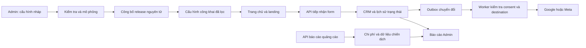

# Hệ thống quản trị đo lường và chiến dịch qua Admin

Ngày: 15/10/2026. Trạng thái: **đặc tả thiết kế để triển khai; chưa phải chức năng đã xây dựng**.

## 1. Mục tiêu và phạm vi

Yêu cầu: sau lần xây dựng này, chủ website và nhân viên có quyền có thể thiết lập, thay đổi, kiểm tra, công bố và theo dõi cấu hình GA4, Google Ads, Meta và nhiều chiến dịch bằng Admin, không sửa mã nguồn cho các thao tác vận hành được hỗ trợ. Một landing có thể phục vụ nhiều chiến dịch; một chiến dịch có nhiều nội dung, link và trang đích. Theo dõi đến form thật, chốt và lắp đặt trong CRM.

Giữ Python/FastAPI, Jinja2, JavaScript nhẹ, Supabase PostgreSQL/Queues và Vercel. Không bổ sung một hệ thống đăng nhập hay một kho lead khác.

“Mọi thông số qua Admin” bao gồm ID, tài khoản, mục tiêu, mapping tham số, nguồn dữ liệu, phạm vi, lịch, ngưỡng, lưu trữ, quy tắc báo cáo và bí mật nhà cung cấp được hỗ trợ. Tham số có kiểu dữ liệu, mô tả, mặc định và giới hạn; không biến Admin thành nơi thực thi JavaScript/Python/SQL hay gọi URL tùy ý.

Các giới hạn cần nói rõ trong sản phẩm:

- Nhà cung cấp mới, giao thức mới hoặc thay đổi API không tương thích vẫn cần cập nhật connector trong phần mềm. Admin hiển thị capability thực có; không quảng cáo “nhập API nào cũng chạy”.
- Khóa mã hóa gốc, Supabase service key, quyền môi trường và root safety caps là cấu hình hạ tầng. Token Google/Meta có thể nhập, thay hoặc kết nối qua Admin; khóa bảo vệ các token không trả về trình duyệt và không chỉnh trong form marketing.
- Ghi cấu hình website không tự sửa tài khoản quảng cáo. Đồng bộ bên ngoài là thao tác riêng, có quyền và bản xem trước.
- Không đặt ngân sách, bật/tắt phân phối quảng cáo trong phạm vi bản đầu. Tạm dừng đo lường không đồng nghĩa tạm dừng quảng cáo.
- Không dùng cấu hình để biến lựa chọn từ chối thành đồng ý hoặc gửi PII vào GA4/UTM. CRM vẫn nhận và xử lý form theo luồng dịch vụ hiện có.

## 2. Hiện trạng đã đọc trong repository

| Thành phần | Hiện có | Phần cần mở rộng |
|---|---|---|
| GA4 | `templates/client/components/google_analytics.html` có ID G-D0J0XLJ891; SDK lọc dữ liệu và consent | Chuyển ID và chính sách hỗ trợ sang cấu hình có phiên bản; không tạo thêm nguồn tag |
| Campaign | `CampaignInput`: name/platform/utm_campaign/branch_id; workspace tạo UTM | Provider account/campaign/ad-group/ad IDs, landing/link association và template |
| Attribution | `/sessions`, `/consent`, `/touches`; click ID mã hóa phía server | Nhiều loại click identifier, schema metadata nguồn, rule phân bổ có phiên bản |
| Link performance | `/admin/link-performance`, source token ký server; form/chốt từ DB | Kết nối với thực thể chiến dịch quảng cáo, breakdown và chi phí nhập/đồng bộ |
| Conversion | Gateway HMAC, job queue, delivery ledger; lead và installed | Routing nhiều destination, secret quản trị, connector thật và chẩn đoán từng item |
| Tích hợp | Integration record hiện chỉ là metadata; capability cho biết gateway cấu hình hay chưa | Không coi enabled record là provider đã xác thực; thêm health/auth/delivery state riêng |
| Quyền | Actor, scope chi nhánh, MFA và SQL dispatch | Quyền marketing chi tiết, publish/replay/secret/API-write tách riêng |

File liên quan: `modules/marketing/{schemas,routes}.py`, `modules/integrations/{routes,schemas,ads,conversions}.py`, `modules/workflow/worker.py`, `modules/link_analytics/`, `static/js/client/{analytics,google_analytics,link_tracking}.js`, `static/js/admin/{workspace,link_performance}.js`. SQL mới phải forward migration qua CLI; không sửa migration đã áp dụng.

## 3. Lựa chọn kiến trúc

| Phương án | Đánh đổi |
|---|---|
| Chỉ dùng GTM cho mọi cấu hình | Nhanh cho tag trình duyệt nhưng không thay quản lý CRM, link, retry, lịch sử và quyền trong Admin |
| **Cấu hình có schema trong Admin + connector Python cố định** | Chọn phương án này: tái sử dụng hệ thống, thay cấu hình không cần deploy, kiểm tra được routing và dữ liệu |
| Trình dựng mã/script tùy ý | Không chọn: khó kiểm soát PII, XSS, đếm trùng và lỗi ảnh hưởng toàn trang |

Bản đầu giữ tag native hiện có. Không chạy song song GTM và native cho cùng destination/event. GTM chỉ là connector tương lai khi có adapter, quy tắc ownership và test chống đếm trùng tương ứng.

## 4. Cấu trúc giao diện Admin

Menu cha **Marketing & Đo lường**, gồm các trang sau; không tạo hai màn hình cạnh tranh cho cùng campaign/link.

| Trang | Chức năng chính |
|---|---|
| Tổng quan | Funnel nguồn → form → chốt → lắp; trạng thái kết nối; chi phí; thời điểm dữ liệu mới nhất |
| Kết nối | GA4/Google Ads/Meta, tài khoản, ID, scope, token, test, kết nối lại, vô hiệu hóa |
| Chiến dịch | Danh sách, bộ lọc, nhân bản, tạo từ mẫu, editor, gắn landing/voucher/link, preview và xuất tham số |
| Link & Nội dung | Mở rộng màn hình link-performance hiện có; creator, ghi chú, nền tảng, ad ID, kết quả |
| Sự kiện & Chuyển đổi | Danh mục hành vi, trigger đã hỗ trợ, mapping provider, giá trị, quy tắc đếm |
| Báo cáo | So sánh campaign/ad group/ad/content/landing/link, funnel, chi phí, nhân viên chốt |
| Chẩn đoán & Lịch sử | Lỗi kết nối, hàng đợi, delivery, test, release diff, rollback và audit |

Editor chiến dịch theo 4 bước: **Thông tin → Trang đích & Link → Đo lường → Kiểm tra**. Mặc định kế thừa cấu hình website. Phần nâng cao thu gọn; hiển thị giải thích thuật ngữ ngay cạnh trường, có ví dụ và nút sao chép. Không buộc chủ website đọc JSON.

Mỗi giá trị kế thừa ghi rõ “Đang dùng từ Website/Landing/Chiến dịch”; chọn Ghi đè mới mở ô chỉnh. Cạnh nút Công bố có tóm tắt thay đổi, điểm lỗi cần sửa và số trang bị ảnh hưởng. Phân biệt “Đã lưu nháp”, “Đã công bố”, “Đã kết nối”, “Đã gửi”, “Được nhà cung cấp chấp nhận”.

Bảng có checkbox, thao tác hàng loạt hỗ trợ từng loại, sort hai chiều server, lọc trạng thái và phân trang. Batch trả kết quả từng mục. Form lỗi giữ nguyên dữ liệu; 409 mở diff, không ghi đè. Mobile không scale toàn trang: form một cột, nhãn đầy đủ, vùng chạm tối thiểu 44px, bảng cuộn trong khung, CTA cố định trong editor không che trường. Ngày `dd/mm/yyyy`, giờ Việt Nam; API dùng ISO 8601 có offset, DB lưu UTC. Accessibility: label, keyboard, focus, thông báo lỗi nối với trường và trạng thái chờ.

## 5. Danh mục cấu hình

### 5.1. Kết nối nhà cung cấp

Chung: tên dễ nhớ, provider, môi trường, owner/team, tài khoản external, trạng thái, capability, lịch sử kiểm tra, thời hạn auth, phạm vi domain, ngày bắt đầu/ngừng, tần suất đồng bộ trong giới hạn hệ thống.

| Provider | Cấu hình được hỗ trợ |
|---|---|
| GA4 | Measurement ID công khai; Property ID và Stream ID phục vụ kiểm tra/báo cáo; OAuth đọc báo cáo; Measurement Protocol secret nếu bật connector server; mode basic/advanced; debug/test |
| Google Ads | Customer ID; login customer nếu thực sự cần; OAuth và secret/developer-token theo capability được cấp; Google tag AW-ID; conversion action resource/label theo cơ chế gửi; currency; timezone tài khoản; route direct hoặc GA4 import |
| Meta | Ad Account ID; Pixel/Dataset ID; token; capabilities/scopes; phiên bản API thuộc danh sách connector đã kiểm chứng; mã Test Events; browser/server mode và mapping event |

OAuth lưu token phía server, refresh qua single-flight/lock; callback kiểm tra state, redirect cố định và PKCE khi flow hỗ trợ. Manual token là ô write-only cho người có quyền: GET chỉ trả configured/last_rotated/expiry, không trả token cũ. Thay secret tạo version; UI yêu cầu xác thực MFA mới. Secret nhập không đưa vào URL, localStorage, audit hoặc export cấu hình.

Secret mã hóa bằng hạ tầng crypto của ứng dụng, lưu trong kho private riêng; không nằm JSON resource thông thường. DB backup có ciphertext; key gốc giữ riêng ở môi trường server. Test kết nối mặc định chỉ đọc hoặc validate; gửi sự kiện thử cần thao tác riêng với synthetic data/Test Events được provider hỗ trợ.

### 5.2. Chiến dịch và link

Field: tên nội bộ, mã nội bộ bất biến, platform, connection, external campaign ID, tên provider lần đồng bộ gần nhất, nhóm/ad ID tùy chọn, người phụ trách, content note, ngày chạy, landing, voucher, mục tiêu chính, tag nhóm và trạng thái. ID nhà cung cấp lưu **string**, không dùng JavaScript Number vì ID có thể vượt số nguyên an toàn.

Mapping URL có UI key/value: utm_source/medium/campaign/content/term/id và bộ external ID của provider. Hỗ trợ literal hoặc biến trong danh sách connector; không eval biểu thức. Template Google phân biệt Final URL suffix với Tracking template; suffix không bắt đầu bằng `?`. Macro còn nguyên sau click được đánh dấu unresolved, không ghi thành ID thật. ID chuẩn ưu tiên để đối chiếu; tên chỉ để đọc vì có thể đổi.

Admin cung cấp link trực tiếp, link content rút gọn và link voucher hiện có. Google Ads dùng final URL thuộc domain hợp lệ; template/suffix được kiểm tra và thử trong Google Ads trước chạy. Redirect phải giữ tham số được phép và không lặp. Không cho redirect tới domain tùy ý. Link rút gọn không bảo đảm được nền tảng quảng cáo chấp nhận trong mọi cấu hình.

Nhiều quảng cáo có thể về cùng URL. Nguồn được phân biệt bởi platform/account/campaign/group/ad/content, không bằng việc đổi Pixel cho mỗi lượt. Một link tạo trong Admin được ký nhằm bảo vệ mapping nội bộ; UTM và ID từ URL thường vẫn là **khai báo chưa được provider xác thực**, không dùng để cấp quyền, chọn secret hoặc ghi chi phí.

### 5.3. Phạm vi và kế thừa

Thứ tự: **mặc định website → domain đã xác minh → landing → override chiến dịch đã công bố**. Override chiến dịch chỉ áp dụng nếu mapping hợp lệ trong cùng môi trường và phạm vi của landing; URL không được mang Pixel ID/AW-ID tùy ý để chọn destination. Chỉ cho override các trường được schema đánh dấu.

Mặc định một GA4 property chính và một business dataset phù hợp; phân loại nhiều campaign bằng metadata. Trường hợp nhiều thương hiệu/tài khoản: Admin chỉ định destination theo scope, không bắn mọi sự kiện tới mọi tài khoản. Tổng hợp multi-account có phân quyền, không trộn currency mà thiếu quy đổi được ghi nguồn.

### 5.4. Sự kiện và chuyển đổi

Event catalog chứa schema và trigger đã thực sự instrument trong app. Admin được đổi nhãn, bật/tắt, map provider, điều kiện allowlist và giá trị; không tạo trigger DOM tùy ý hoặc tự nhận một tên mới là đã hoạt động.

| Nguồn thật | Ý nghĩa | Quy tắc đếm |
|---|---|---|
| Xem/chọn gói, đổi kỳ, phụ kiện | Quan tâm sản phẩm | Browser event có consent, không là bằng chứng chốt |
| Mở/bắt đầu form, click gọi/Zalo/Messenger | Ý định liên hệ | Secondary/diagnostic mặc định; không coi click là đã liên lạc |
| Form được backend tiếp nhận | Lead thành công theo yêu cầu đã chốt của chủ website | Sau transaction commit; retry cùng receipt không tạo event mới |
| CRM xác nhận qualified | Lead đủ điều kiện theo thao tác có quyền | Chuyển trạng thái hợp lệ; không suy từ điểm tự động |
| CRM xác nhận closed | Đã chốt | Theo lịch sử CRM và conversion occurrence bất biến |
| CRM xác nhận installed | Lắp đặt | Khác với closed; không đếm hai lần thành hai khách |
| Thanh toán xác nhận | Tiền thực thu | Chỉ bật khi có nguồn thanh toán/nghiệm thu tin cậy, không suy từ kỳ hạn hoặc số tiền dự kiến |

Mapping có provider event chuẩn hoặc tên custom được connector cho phép; action/label, currency, value_source, mục tiêu primary/secondary, counting và event_time thực. Không gửi `purchase`/doanh thu cho form tư vấn. Giá trị dự kiến phải gắn nhãn expected, tách khỏi realized revenue.

Nếu một lead lùi rồi quay lại trạng thái, lần chốt/lắp đầu của cùng cơ hội không phát sinh conversion mới chỉ do thao tác qua lại. Hủy/hoàn tiền tạo adjustment nếu connector hỗ trợ; nếu chưa hỗ trợ hiển thị cần đối soát. Không xóa lịch sử để làm đẹp tỷ lệ.

Google direct và GA4-import cho cùng thành quả có thể cùng quan sát, nhưng chỉ chọn một đường làm mục tiêu tối ưu chính; publish validator chặn cấu hình primary trùng trong phạm vi quản lý. Primary bên tài khoản Google cần đồng bộ/kiểm tra riêng, không coi toggle website đã đổi tài khoản.

### 5.5. Consent, tham số và lưu trữ

Admin chỉnh nội dung banner, ngôn ngữ, mode được hỗ trợ, nhóm mục đích, thời hạn lựa chọn, lịch lưu/xóa và danh sách tham số công khai được phép. Google có bốn trạng thái riêng: analytics_storage/ad_storage/ad_user_data/ad_personalization. Lựa chọn marketing cũ không tự nâng thành cả bốn granted; quyền mới cần lựa chọn phù hợp và journal phiên bản.

Trạng thái chưa chọn/từ chối đi theo policy của connector; advanced Google chỉ gửi tín hiệu hạn chế đúng cơ chế của Google, không trở thành full tracking. Meta browser/server và customer-data upload phải qua cổng mục đích tương ứng. Thu hồi áp dụng ngay tại client và trước mỗi lần worker gửi; dữ liệu đã gửi trước đó xử lý theo cơ chế nhà cung cấp, không hứa có thể thu hồi packet đã đi.

Tên, điện thoại, địa chỉ, ghi chú, OTP, token, IP và tọa độ không được chọn vào generic event mapping/URL. Customer-data matching nếu bổ sung phải là capability riêng: normalization/hash theo provider, consent, access, retention và test riêng; không bật chỉ vì nhập Pixel ID. Hash không biến dữ liệu cá nhân thành dữ liệu vô danh.

TTL cho cấu hình, phiên và retention chỉnh trong miền min/max của hệ thống/provider. Schema public chỉ trả ID công khai, rule đã biên dịch, version và capability; không trả credential, OAuth state, lookup map riêng tư hoặc địa chỉ gateway nội bộ.

## 6. Mô hình dữ liệu đề xuất

Các bảng nghiệp vụ trong private schema, API qua FastAPI và `api.dispatch`; kiểm tra quyền tại Python và transaction SQL. Không cấp anon/authenticated quyền đọc secret. RLS phòng thủ cùng grants, không dùng SECURITY DEFINER rộng để giải quyết lỗi quyền.

| Thực thể | Trách nhiệm và ràng buộc |
|---|---|
| measurement_connections | Provider/account/environment, status, capability và public settings; unique provider/account/environment theo phạm vi business |
| measurement_secrets | Ciphertext, connection, key_version, expiry/rotation; server-only; không log payload |
| measurement_configs | Draft có schema_version và expected_version; nguồn scope, owner và trạng thái |
| measurement_releases | Snapshot bất biến, hash, người công bố, thời điểm, effective policy; activation pointer nguyên tử |
| measurement_destinations | Target account/property/dataset, scope và connection reference; không chọn từ browser payload |
| measurement_rules | Event catalog reference, predicate allowlist, mapping, counting, giá trị và destination |
| campaign_external_entities | Map resource campaign hiện có → platform/account/external ID; group/ad là con; tên cập nhật không đổi ID |
| source_touches | Mở rộng touches hiện có; metadata chuẩn hóa, provenance, click ID có type/ciphertext/expiry và consent version |
| lead_measurement_context | Snapshot source/landing/link/campaign và release tại tiếp nhận; không sao chép PII; liên kết CRM hiện có |
| conversion_occurrences | Thành quả từ transaction CRM, stage, event_time, identity ổn định, money provenance; unique opportunity/stage theo quy tắc |
| measurement_deliveries | Occurrence + destination + rule identity; unique chống nhân đôi; attempt, provider reference, trạng thái và payload hash |
| campaign_cost_facts | Account/campaign/group/ad/date/source/currency, import batch/version và sync watermark; API snapshot upsert, không cộng lặp mỗi lần sync |
| measurement_checks | Health/capability/test, kết quả đã lọc, thời điểm; validation không giả làm provider acceptance |

Tái sử dụng campaign resources, links, sessions, leads, audit và jobs hiện có. Không thay toàn bộ resource store chỉ để thêm subsystem. Migration chuyển delivery gateway cũ sang legacy destination rõ ràng, giữ event IDs đã gửi; không tạo lại conversion lịch sử.

## 7. Runtime, độ trễ và công bố

1. Admin lưu draft với expected_version, validate schema/reference/scope. Save không kích hoạt gửi.
2. Simulator cho chọn trang, campaign, event và consent giả lập; trả effective config, destination, lý do được gửi/bị chặn, preview payload đã che dữ liệu. Dry-run không gọi API ghi dữ liệu ngoài.
3. Publish lock scope và kiểm tra lại tham chiếu/version; tạo snapshot và đổi active pointer trong một transaction. Config sai không thay last-known-good.
4. Public config phục vụ cùng origin, ETag/hash theo release, cache ngắn đề xuất 60 giây; có version-check khi tab được focus và định kỳ khi active. Không cam kết tab offline tự cập nhật. HTML cached không nhúng secret; tránh chọn config theo query rồi dùng chung cache giữa các landing.
5. SDK đọc config bất đồng bộ, tải thư viện một lần/provider và tách khỏi submit lead. Config/tag/provider lỗi không chặn nhận form. Tab đang mở có thể còn script cũ; disable dừng event do ứng dụng phát và server delivery khi nhận cấu hình mới, không hứa gỡ được packet/script đã tải.
6. Lead/CRM commit outbox trong transaction. Worker claim hữu hạn, lấy destination từ snapshot, kiểm tra policy/consent/disable hiện hành và ghi ledger trước khi gửi. Không gọi Ads ngay trong request gửi form.
7. Retry giữ event identity/payload semantic snapshot, không tự chuyển account hoặc rule mới. Token rotation cùng account dùng secret mới; đổi account cần destination mới. Một config revision không là lý do tạo conversion thứ hai.
8. HTTP 2xx chỉ là transport: connector phải parse per-item/partial failure. Timeout không rõ kết quả → unknown; chỉ retry tự động nếu cơ chế dedupe của destination được kiểm chứng, dùng cùng identity. Không hứa exactly-once cho tác động API ngoài.
9. Supabase queue/cron đánh thức worker theo kiến trúc hiện có. Batch/concurrency/backoff/deadline do policy giới hạn; không dùng daemon hoặc background task sau response trong Vercel.

Mục tiêu nghiệm thu, chưa là số đo: publish được khách online nhận trong tối đa khoảng 60 giây theo cache/version-check; không thêm API provider vào critical path form; đo chênh p95 trước/sau; client payload config public mục tiêu ≤15 KB gzip. Nút emergency disable server được kiểm tra ở mọi delivery; tác vụ đang gửi có thể đã rời hệ thống, phải thể hiện giới hạn đó.

## 8. Attribution và báo cáo

Giữ first touch, latest eligible non-direct touch và link source của form như các trường riêng. Mặc định báo cáo điều hành dùng **latest eligible non-direct**, cửa sổ đề xuất 30 ngày trong miền hệ thống hỗ trợ; khách không có lịch sử hợp lệ vào unknown. Direct không xóa một nguồn hợp lệ còn hạn. Admin đổi mô hình/cửa sổ cho báo cáo mới; result trả model_version và ngày hiệu lực, không rewrite snapshot nguồn cũ. Không có consent thì không tạo hành trình dài hạn thay thế bằng fingerprint/IP hash.

Click ID của nền tảng là identifier opaque; không giải mã campaign từ gclid/fbclid và không tự chế gbraid/wbraid/_fbc. Thu thập loại thực sự hiện diện và xử lý đúng capability/provider hiện hành. URL macro unresolved, consent thiếu hoặc click ID hết hạn là trạng thái chất lượng dữ liệu, không tự bịa nguồn.

Mẫu số phải ghi rõ:

- Click quảng cáo do provider báo, click link server và phiên website đo được là ba đại lượng khác nhau; không đặt cùng nhãn hoặc tính CTR bằng website visits.
- Form thành công = backend commit; báo riêng yêu cầu tiếp nhận và khách/cơ hội distinct để lộ duplicate, không biến mọi lần submit thành khách mới.
- Chốt/lắp theo cơ hội distinct; phân biệt cohort nhận lead với hoạt động chốt trong kỳ. Chốt có thể xảy ra sau kỳ quảng cáo.
- Time on site là active measured time; có coverage, timed_visits và unknown, không thay null bằng 0.
- CPL = chi phí / lead theo định nghĩa đã chọn; CAC = chi phí / khách chốt; denominator 0 trả null. ROAS chỉ có realized revenue và currency/time window tương thích. Không coi tổng cước dự kiến là tiền thu.

Chi phí nhập tay và API không cùng cộng cho một khoản. Mỗi campaign/date chọn source of truth; manual adjustment là bản ghi riêng có lý do. API dùng unique grain và upsert snapshot; phân biệt source timezone với ngày quy đổi Việt Nam. Không cộng rollup campaign với ad-level làm gấp đôi chi tiêu. Báo cáo có completeness, last_synced_at, sync errors và conversion lag.

Data API quảng cáo/báo cáo không thời gian thực cứng. CRM là nguồn đối chiếu form/chốt; Google/Meta có mô hình, cửa sổ và cross-device khác nhau. Không cộng conversion Google + Meta để ra số khách thực. Không tuyên bố mô hình attribution chứng minh tác động nhân quả.

Dashboard: KPI, funnel, xu hướng ngày, breakdown, bảng nguồn, tỷ lệ lead không hợp lệ, tốc độ xử lý/nhân viên chốt, đối soát provider và cảnh báo. Ranking kế thừa Wilson/cohort maturity đã có; minimum sample/window chỉnh trong miền hợp lệ, không gán nhãn thắng khi chưa đủ mẫu. Cảnh báo mất event, token hết hạn, tỷ lệ lỗi/retry và chênh dữ liệu chỉ có ý nghĩa khi có coverage/cửa sổ so sánh phù hợp.

## 9. API đề xuất, không phải endpoint đã có

Namespace `/api/v1/admin/measurement`, mọi mutation dùng session/CSRF, quyền server, MFA khi nhạy cảm, expected_version và idempotency phù hợp.

| Endpoint tương đối | Trách nhiệm |
|---|---|
| GET `/capabilities`, `/schemas` | Khả năng connector/schema và giới hạn thực; không lộ credential |
| GET/POST `/connections`, PUT `/connections/{id}` | Danh sách/editor cấu hình |
| POST `/connections/{id}/credentials` | Write-only thay secret, không echo |
| POST `/connections/{id}/oauth/start`, GET callback cố định | Kết nối quyền provider; state gắn actor/session |
| POST `/connections/{id}/check` | Read-only check mặc định, kết quả có checked_at |
| GET/POST `/configs`, PUT `/configs/{id}` | Draft/version |
| POST `/configs/{id}/simulate`, `/validate`, `/publish` | Xem effective payload, kiểm tra, kích hoạt |
| GET `/releases`, POST `/releases/{id}/restore` | Lịch sử và tạo release mới từ snapshot cũ, không rewind audit |
| POST `/connections/{id}/disable` | Dừng gửi bằng policy server và cập nhật public config |
| GET `/campaigns/{id}/tracking`, POST `/campaigns/{id}/links` | Tạo template/link, map campaign cũ; không tạo catalog cạnh tranh |
| POST `/campaigns/{id}/sync-preview`, `/sync-apply` | Thay URL parameters ngoài khi có capability; diff, hash và quyền riêng |
| GET `/deliveries`, POST `/deliveries/{id}/retry` | Delivery có lọc/redact; retry có điều kiện và giữ identity |
| GET `/reports`, POST `/cost-imports/preview`, `/cost-imports/apply` | Báo cáo và nhập chi phí chống trùng |
| POST `/sync-jobs` | Xếp lịch/trigger sync giới hạn, không chờ API dài trong UI |

Public config: GET `/api/v1/measurement/config?landing=...`; server resolve host từ origin tin cậy và landing đã công bố, trả effective public settings/ETag. Public event endpoint chỉ nhận catalog schema, không nhận provider/credential/event_time/chốt từ client. Endpoint touches hiện có mở rộng tương thích; nguồn CRM mới luôn đi server.

External write flow: preview trả diff/current-provider-version/hash; apply kiểm tra lại quyền, target, version và confirmation token có hạn. Nếu provider đổi giữa hai bước trả conflict. Publish website và provider apply là hai state riêng; không giả vờ transaction xuyên hai hệ thống. Ghi audit metadata trước/sau đã lọc, có khả năng thực hiện lại theo idempotency hỗ trợ.

## 10. Phân quyền và kiểm soát thay đổi

Quyền đề xuất cần migration và test, không suy rằng đang tồn tại: measurement.read, measurement.configure, measurement.publish, measurement.credentials, measurement.replay, measurement.external_write. Phạm vi business/account/branch rõ ràng; role label không tự cấp quyền.

Mặc định chủ: toàn quyền sau MFA. Marketing: tạo campaign/link/draft và xem báo cáo phạm vi được cấp, không đọc secret, không tự cấp account mới. Nhân viên bán hàng: CRM khách được phân công, nguồn đọc được theo scope, không thay mục tiêu/chỉ số. Reviewer chỉ xem cấu hình/payload đã redacted. Audit có actor/thời điểm/object/version, không log token/số điện thoại/IP thô.

Bulk 50 mục tối đa theo chuẩn hiện có: pause/resume measurement, gắn tag/owner hoặc archive khi hỗ trợ; kết quả từng item và conflict độc lập. Không bulk rotate secret hoặc đổi destination account âm thầm. Campaign đã có số liệu archive thay hard delete. Xóa dữ liệu theo privacy workflow khác archive cấu hình.

## 11. Tiêu chí nghiệm thu bắt buộc

1. Đổi GA4 ID, Pixel ID, conversion mapping, UTM, landing và thời gian chạy qua Admin mà không sửa file/deploy web; preview hiển thị thay đổi trước publish.
2. Ít nhất 2 campaign Google và 2 campaign Meta cùng một landing vẫn phân tách form, closed, installed; ID/tên/nguồn không bị overwrite qua điều hướng/retry.
3. Mã nguồn không còn ID marketing riêng cho production ngoài bootstrap/import ban đầu; cấu hình khi lỗi dùng release đã biết hoặc dừng tracking, không mất lead.
4. Một form retry/reload, một CRM transition lặp và worker crash/timeout không làm tăng số cơ hội thành công; test browser+server dedupe mỗi provider, per-item failures và trạng thái unknown.
5. Chưa chọn, từ chối, đồng ý một phần, đồng ý đủ, thu hồi, tab mở lâu và config lỗi được kiểm thử độc lập. Preview/Admin không gửi production tracking.
6. Secret không có trong HTML/public config/log/audit/export; API GET không trả plaintext; người không quyền/sai branch và thiếu MFA bị chặn cả Python lẫn SQL.
7. Publish đồng thời, stale expected_version, rollback, token hết hạn, OAuth CSRF, SSRF qua URL và giả metadata bị kiểm thử. Không có trường arbitrary script hoặc endpoint tùy ý.
8. Chi phí đồng bộ lại/nhập trùng không cộng đôi; Google/Meta totals không giả là CRM distinct; chưa có revenue/denominator trả unknown/null phù hợp.
9. Mobile 360/390/430px, desktop 1440px: không tràn ngang toàn trang, không mất nhãn, keyboard/focus/error/busy hoạt động; ngày hiển thị dd/mm/yyyy.
10. Đối soát riêng số transaction CRM, occurrence, delivery và số accepted/rejected/unknown; không coi dataLayer push/HTTP 2xx là bằng chứng provider đã attribution.
11. Tag Assistant/GA DebugView/Meta Test Events chỉ đánh dấu đạt sau kiểm tra thật có quyền và test-safe; automation mock không đủ để gọi provider production verified.
12. Migration additive giữ form/voucher/source/report cũ hoạt động; old/new web chạy đồng thời được, rollback web không phá schema.

## 12. Phân kỳ triển khai và mức hoàn thiện

| Giai đoạn | Kết quả có thể sử dụng | Điều kiện hoàn thành |
|---|---|---|
| A. Cấu hình và giao diện | Connection/config/rule registry, write-only secrets, draft/simulate/publish/rollback; migrate GA4 ID; campaign/template/link editor | Admin vận hành được, test quyền/consent/version; connector chưa nối ghi rõ chưa kết nối |
| B. Attribution và conversion | Metadata đa chiến dịch, snapshot CRM, destination routing, provider adapters, outbox/dedupe/retry | Provider test evidence thực từng connector; Google/Meta không chỉ là gateway placeholder |
| C. Báo cáo và đồng bộ | OAuth/report sync, cost reconciliation, campaign/ad breakdown, cảnh báo; external URL-update preview/apply khi đủ quyền | API capability và quota được xác minh; user kết nối tài khoản, test ngoài hệ thống có ghi nhận |

Đây là một hệ thống, nhưng mỗi giai đoạn cần kế hoạch triển khai/test riêng. Không bật server upload chỉ để hoàn thành checkbox khi chưa có consent/mapping/credential/capability. Không tự tạo hoặc chạy quảng cáo bằng việc công bố cấu hình.

## 13. Tài liệu đối chiếu và điểm cần xác minh khi code connector

- [Google conversion tags và conversion actions](https://developers.google.com/tag-platform/devguides/conversions).
- [Google ValueTrack](https://support.google.com/google-ads/answer/6305348?hl=en), [auto-tagging](https://support.google.com/google-ads/answer/3095550?hl=en), [GA4–Ads linking](https://support.google.com/analytics/answer/9379420?hl=en).
- [Google primary/secondary conversions](https://support.google.com/google-ads/answer/11461796?hl=en).
- [Google consent setup](https://developers.google.com/tag-platform/security/guides/consent).
- [Google offline conversions](https://developers.google.com/google-ads/api/docs/conversions/upload-offline): tài liệu hiện chuyển hướng sang trang này; chọn endpoint và quyền theo connector/account hiện hành, không đóng đinh API cũ.
- [Supabase Queues](https://supabase.com/docs/guides/queues), [Vercel Python runtime](https://vercel.com/docs/functions/runtimes/python).
- Meta: Business Help yêu cầu đăng nhập và developer docs trả 429 khi đọc trong phiên thiết kế này. Dynamic parameter list, API version, supported event names, event deduplication/retention và account scopes phải kiểm tra bằng tài liệu hiện hành + Test Events khi triển khai; chưa coi connector Meta đã được chứng nhận.

Không có migration, credential, quảng cáo hay cấu hình production nào được thay đổi bởi tài liệu này.
